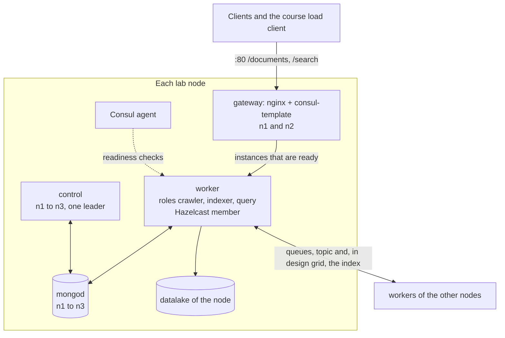

# Query Tarantino · Stage 3

Distributed search engine over [Project Gutenberg](https://www.gutenberg.org/) books in Java 25, with Javalin and Jackson, on a cluster of lab computers. One `worker` process per node can ingest, index and search: its roles `crawler`, `indexer` and `query` are assigned at run time. The workers coordinate through Hazelcast, the source of truth is a MongoDB replica set, and Consul with nginx sends each search to an instance that is ready to answer it. Two index designs are deployed and compared: `local`, a complete index copy in every search instance, and `grid`, one index partitioned in the memory of the workers.

**Demonstration video:** to be linked here when it is uploaded, `[Stage 3] Search Engine Project – Query Tarantino (ULPGC)`.

## Documentation

| Guide | What it covers |
| --- | --- |
| [docs/deployment.md](docs/deployment.md) | The lab machines, the prerequisites of each one, and how to deploy, inspect and stop each design |
| [docs/running.md](docs/running.md) | The single-host stack for development, every endpoint to try and every variable |
| [checks/README.md](checks/README.md) | The functional API checks, the OpenAPI validation and the query equivalence |
| [scripts/bench/README.md](scripts/bench/README.md) | The corpus, each experiment with its official run, and the campaign |
| [scripts/chaos/README.md](scripts/chaos/README.md) | The node-loss scenarios on the lab: what each stops and how to run it |
| [scripts/recovery/README.md](scripts/recovery/README.md) | The process-failure matrix that CI runs on one machine |
| [benchmarks/README.md](benchmarks/README.md) | What the runs show, and [benchmarks/figures.csv](benchmarks/figures.csv), which maps every figure of the report to its runs |
| [SPEC.md](SPEC.md) | Every contract: collections, messages, states, conditional writes, the HTTP API, the two index designs, discovery and routing, roles, failures and runs |
| [api/openapi.yaml](api/openapi.yaml) | The HTTP API in OpenAPI 3.1, derived from `SPEC.md` §6 |
| [report/QueryTarantino_Stage3_Report.pdf](report/QueryTarantino_Stage3_Report.pdf) | The Stage 3 report |

## Structure

On every node the same pieces, started from one Compose file. `SPEC.md` §2.1 has the full diagram.



## Status

F0. The repository starts from `stage_2` `main`; nothing of Stage 3 has run on the lab yet. D updates this section when each gate closes.

## Prerequisites and versions

To build and test, on a member's own computer:

| Tool | Version |
| --- | --- |
| Java | 25 |
| Maven | 3.9 or later |
| Docker with Compose | For Testcontainers and the development stack |
| Bash | 4 or later; macOS ships 3.2, so `brew install bash` |

On the lab nothing is installed and nothing survives between sessions. Every lab computer has Bash, `curl`, SSH and Docker, and `cluster/session.sh` brings the rest. CI builds the images for `linux/amd64` and pushes them to Docker Hub as `querytarantino/<image>:<commit>`; each session pulls them once on the operator machine, a lab computer that is not a node, and loads them on the nodes ([docs/deployment.md](docs/deployment.md)).

## Tools and their configuration

| Tool | Version | What it does here | Its configuration |
| --- | --- | --- | --- |
| Hazelcast | The one in the parent `pom.xml` | Queues, topic and, in design `grid`, the index; a member embedded in every worker | `common`, from the variables of `SPEC.md` §4.7 |
| MongoDB | 7.0 | Source of truth; replica set `tarantino-rs` on `n1` to `n3` | `cluster/compose.node.yml`, `cluster/mongo/init-replica-set.js` |
| Consul | Pinned in `cluster/compose.node.yml` | Discovery and readiness checks; servers on `n1` to `n3` | `cluster/consul/` |
| consul-template | Pinned in `cluster/gateway/Dockerfile` | Renders the nginx upstreams from Consul | `cluster/gateway/upstreams.ctmpl` |
| nginx | Pinned in `cluster/gateway/Dockerfile` | The gateways on `n1` and `n2`: port 80 public, port 8081 operations | `cluster/gateway/nginx.conf` |
| Docker Compose | The lab's, or the one pinned in `cluster/session.sh` where the lab has none | One file for every node | `cluster/compose.node.yml`, `cluster/designs/`, `cluster/configurations/`, `cluster/timing.env`, `cluster/resources.env`, and `cluster/inventory.env`, written by each session |
| Docker Hub | Public repositories of `querytarantino` | Brings the images of each commit to the lab | `.github/workflows/images.yml` and `corpus.yml` |

## Build and test

```bash
mvn clean verify                              # every module, with the MongoDB tests on Testcontainers
mvn -pl services/indexer -am verify           # one module with what it needs
```

GitHub Actions runs on every push `mvn clean verify`; the functional checks on the single-host stack in both designs; the linters; and `bench figures`. The thirteen rows of the process-failure matrix run in each design on every pull request to `main`. On every push to `dev` and `main` it also pushes the images of that commit to Docker Hub. The workflows are in `.github/workflows/`.

## Deploying each design on the lab machines

From the operator machine, a lab computer that is not a node:

```bash
curl -fsSLO https://raw.githubusercontent.com/Query-Tarantino/stage_3/<commit>/cluster/session.sh
bash session.sh start <commit> <host of n1> <host of n2> <host of n3> <host of n4>
cd ~/tarantino/stage_3
cluster/deploy.sh local W4              # design local on four nodes
cluster/status.sh                       # every node, its processes, its workers and their roles
curl -i 'http://<address of n1>/documents/pride+prejudice'
cluster/teardown.sh                     # stop everything and delete its data
cluster/deploy.sh grid W4               # design grid on the same four nodes
cluster/session.sh end                  # before leaving: push the session's runs, or they are lost
```

A design never starts over the data of the other: `teardown.sh` always goes first. [docs/deployment.md](docs/deployment.md) has the inventory, the ports and what to do when a node does not come up.

## Reproducing the experiments

```bash
scripts/bench/all.sh --dry-run                      # the whole campaign, step by step, without running it
scripts/bench/design-comparison.sh                  # ingestion, indexing, search and resources, both designs, W1 to W4
scripts/bench/grid-backups.sh                       # design grid at W4 without backups, against the W4 trials
scripts/bench/index-freshness.sh grid               # from a published update to correct answers
scripts/bench/routing-trace.sh local                # an instance joining, leaving and recovering
scripts/bench/role-rotation.sh local                # the node-by-task matrix
scripts/bench/queue-take.sh transactional          # a lost message's way back, on the development stack
scripts/chaos/F1-one-node.sh grid                   # one node stopped under load, with availability and integrity
```

Every script writes a run in `benchmarks/runs/<run_id>/` with its `manifest.json`, its raw data and its `summary.csv`. The corpus comes from `scripts/fill_cache.sh` and is checked against `workload/corpus.sha256`; the expected answers are in `workload/expected/`. The course load client is not in this repository: it is built from the source the professors handed out and runs unchanged except for its address, as `java -jar load-test.jar http://<address of n1>:80`, and `checks documents` then checks that its answers equal `/search`.

## Repository

```text
report/                 the Stage 3 report and its LaTeX source
common/                 shared contracts
worker/                 the one application process: HTTP, Hazelcast member, registry, roles
services/
  crawler/              role crawler and the documents of a node
  indexer/              role indexer and the index writers of both designs
  query/                role query in both designs, and readiness
  control/              leadership, seeding, reconciliation, roles and repair
bench/                  load generator, oracle, availability, integrity and result processing
checks/                 functional API checks and query equivalence
api/openapi.yaml        HTTP API
cluster/                the deployment: one Compose file for a node, one configuration per design, Consul, gateway
docker-compose.dev.yml  single-host stack for development and CI
scripts/
  bench/                one script per experiment, and all.sh for the campaign
  chaos/                one script per node-loss scenario
  recovery/             one script per row of the process-failure matrix
benchmarks/
  README.md             what the runs show
  figures.csv           every figure of the report and the runs behind it
  runs/<run_id>/        every official run, versioned
workload/               book ids, tranches, queries, stopwords, checksums and expected answers
```
