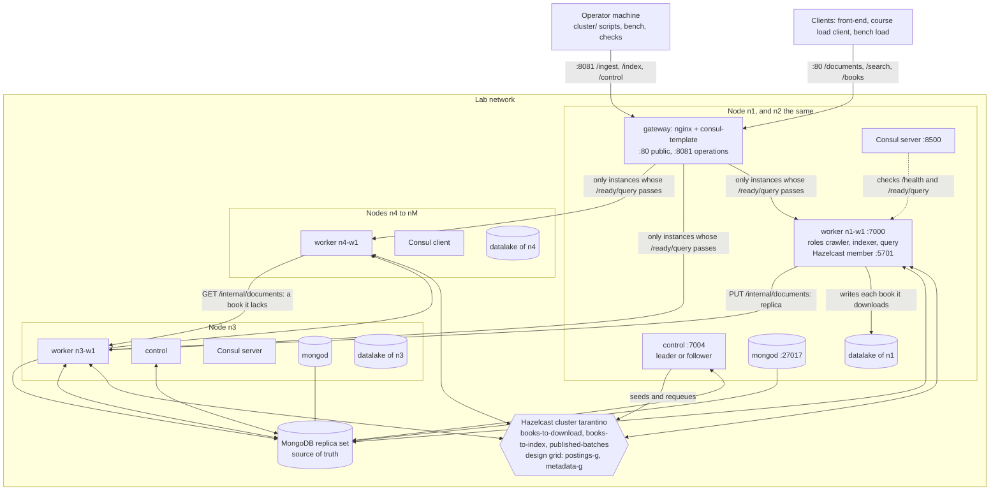

# Query Tarantino · Stage 3 · SPEC

Version 2.0 · November 24, 2026 · draft until the F1 gate

Stage 3 contracts. Everything shared by two or more modules has its literal name here and, in code, lives only in `common`. If something is not here, ask before inventing it.

- It replaces the Stage 2 `SPEC.md` (1.11), which stays in `stage_2`. §10 says what moves from Stage 2 and what does not.
- The assignment is the Stage 3 PDF, “Building and Evaluating a Distributed Search Cluster”. Where this file cites it, it says “PDF §n”.
- The reasons behind each decision are in the Stage 3 plan, which the team keeps outside the repository. If the plan and this file disagree, this file wins and the plan gets fixed.
- A contract change goes in a separate PR reviewed by all four members. That PR bumps the version of this file and updates `common`, `api/openapi.yaml` and, when affected, the plan and the team's notes for each module, all at once. Nobody changes a contract inside the PR for their own piece.

## 1. Scope and assumptions

The Stage 2 search engine over Project Gutenberg now runs on a cluster of lab computers, and every service is replicated across machines. One deployable, the `worker`, runs on every node and can ingest, index and search: its roles `crawler`, `indexer` and `query` are assigned at run time (§13). `control` seeds and reconciles on three nodes with one leader. The texts stay in a datalake on the nodes' disks, each book on `TARANTINO_DOCUMENT_REPLICAS` nodes, and the source of truth in MongoDB.

Two index designs are deployed and compared, selected with `TARANTINO_INDEX_DESIGN` (§11):

- `local`: every search instance holds a complete copy of the index in its own memory, loaded from the versioned batches the indexers publish.
- `grid`: one logical index lives in Hazelcast maps whose partitions and backups are spread over the memory of the workers, and part of each query runs on the members that own the data.

Everything else is the same in both: the corpus, the tokenizer, the documents and their placement, MongoDB, the §5.1 conditional writes, the coordination through Hazelcast queues, the gateway, the API and the search algorithm. That is what makes the comparison of §9 a comparison of one decision.

The design depends on these assumptions:

- A node is one physical lab computer, `n1` to `n<M>` in `cluster/inventory.env` with its lab address. No code depends on which node a process runs on: addresses come from the configuration, the worker registry (§4.3) and Consul (§12).
- A session gets as many lab computers as are free (§2.4). A measured session uses five: four nodes, `n1` to `n4`, and the operator machine. Everything in this file uses `n1` to `n4`, except the scenario `F3-three-nodes`, which needs six nodes (§8.3). The operator machine is never a node.
- A node fails by stopping, with every process killed at once, or by freezing, with every process paused at once while its connections stay open (§8.3). Killing a node's containers is the node failure the professors accept. A cut network is not tested, because it needs root on the lab computers, and a node that answers wrongly on purpose is out of scope.
- MongoDB is a replica set of three members, on `n1`, `n2` and `n3`. Every state change is still a single-document write, with write concern `majority` and no transactions. With two members lost nothing can be written.
- Expirations are compared with MongoDB's time (`$$NOW`), the primary's clock. The nodes keep their clocks with NTP, every run records the offset of each node (§9), and a failover can shift `$$NOW` by the offset between two members, far below any lease.
- Hazelcast and Consul are not the source of truth. A message, a grid entry or a health state can be lost or late: MongoDB decides who owns a job and which batches are published, and the documents on the nodes' disks are the durable copy of the texts. Every index is derived from those two and can be rebuilt from them (§5.4).
- The lab network is trusted. The operational and internal ports have no authentication and are reachable only from it (§6.1). Its firewall is disabled, so every port is open between its computers.
- Nothing survives on a lab computer from one session to the next. A session builds everything from the images on Docker Hub and the repository on GitHub, and its runs exist only once its branch is pushed (§2.4).
- Results come from the lab cluster. The single-host stack, `docker-compose.dev.yml`, is for development, CI and the process-failure matrix (§8.2): several containers on one computer do not demonstrate deployment across machines (PDF §2.1). The one exception is `queue-take` (§9), which measures how a message comes back and stands next to Stage 2's single-host runs.

What the cluster still depends on when every application service is replicated is in §8.1.

### 1.1 Terms

Each term means only this, here and in the team's notes.

| Term | Meaning |
| --- | --- |
| Node | A physical lab computer, `n1` to `n<M>` in `cluster/inventory.env` |
| Operator machine | A lab computer that is not a node, from which every script, `bench` and `checks` run, the last two from the `tarantino-bench` image. Nothing under test runs on it |
| Session | The time the team holds a set of lab computers, from `cluster/session.sh start` to `cluster/session.sh end` (§2.4). Nothing survives from one session to the next |
| Worker | One `worker` process, named by its `worker_id`, `<node>-w<k>`. A node runs one, or two in configuration `W2P4` |
| Role | `crawler`, `indexer` or `query`: a task a worker runs while it is assigned to it (§13) |
| Service instance | A worker with a role `ACTIVE`: a crawling, an indexing or a search instance. The PDF calls it a service replica |
| Data replica | A copy of a document, of the index or of an index partition. It is not a service instance: a worker can hold data it does not serve (§4.2) |
| Supporting infrastructure | Everything that is not a worker: the gateways, Consul, MongoDB, `control` and the Hazelcast cluster |
| Design | `local` or `grid` (§11). A deployment has one |
| Configuration | Which nodes run a worker and how many each: `W1` to `W4`, `W2P4` and, for one scenario, `W6` (§9) |
| Batch | The unit in which books are indexed and published (§5.1). Nothing of a batch is searchable until it is `PUBLISHED` |
| Generation | One complete index of every book. A rebuild writes the next one and then switches the pointer to it (§5.4) |
| Index state | The immutable set of published batches of one generation that a search instance answers from (§7) |
| Index version | The name of an index state (§7). Two answers with the same version were computed on the same logical index |
| Acknowledged | A document is acknowledged when “Finish a download” matched, and an index update when “Publish a batch” matched. Work that was not acknowledged was never stored, whatever was written on the way |
| Ready | A search instance whose `GET /ready/query` answers `200` (§12.2). The gateways route searches only to ready instances |
| Eligible backend | A search instance that was ready when an update was acknowledged. Freshness is measured on every eligible backend (§9) |
| Within tolerance | A fault that stops no more than the supported failure limit of §8.1: one node, in both designs. Any other fault is a limit test |

## 2. Architecture

### 2.1 Diagram



The life of a book: `control` seeds it; a worker with the role `crawler` downloads it, stores it on its node and on other nodes and enqueues it; a worker with the role `indexer` reads it from a node that holds it and publishes it in a batch; every worker with the role `query` makes that batch searchable, and the gateway only routes to the ones that are ready.

The diagram is the same in both index designs. §11 says what changes: where the postings and the metadata of a batch are written, where a search reads them and where it computes.

### 2.2 Modules

| Module | Responsibility | Deployment |
| --- | --- | --- |
| `common` | Shared contracts: names, enums, records, JSON, configuration, tokenizer, stopwords, datalake paths, languages, Problem Details, the `book_id` parser, `/health`, the logs of §4.8, crash points and the lease heartbeat; in Mongo, the client, the indexes, the shared writes of §5.1 and the worker registry; in Hazelcast, the member and client factories, the names of §4.2 and the grid types and tasks of design `grid`; the `Role` contract (§13) | Dependency of the others |
| `services/crawler` | Role `crawler`: consumes `books-to-download`, claims each book, downloads it, stores it on its node, replicates it and enqueues it in `books-to-index`; serves the documents of its node to other workers | Library of `worker` |
| `services/indexer` | Role `indexer`: groups `books-to-index` into batches, reads each book from a node that holds it, writes the batch into the index of the design and publishes it | Library of `worker` |
| `services/query` | Role `query`: keeps the index state of the design, a local copy or a snapshot over the grid, answers the search API and reports its readiness | Library of `worker` |
| `worker` | The only application deployable: one process with the HTTP server, the embedded Hazelcast member, its registration in MongoDB and Consul, and the three roles, started and stopped by assignment (§13) | One per node of the configuration; two per node only in `W2P4` (§9) |
| `services/control` | Seeds, reconciles, assigns roles, repairs under-replicated documents and drives rebuilds; one leader at a time (§5.3) | `n1`, `n2` and `n3` |
| `bench` | Load generator, oracle of expected results, the resource recorder, the availability, integrity, freshness, routing, matrix, network and recovery-delay tools, result processing and XChart charts | Not deployed with the cluster: on the lab it runs on the operator machine from the `tarantino-bench` image (§2.4) |
| `checks` | Functional API checks and query equivalence (§9) against a running deployment and against `api/openapi.yaml` | Not deployed with the cluster: in the `tarantino-bench` image, like `bench` |
| `cluster/` | Deployment: the session scripts, one Compose file for a node, one configuration per design and per scaling configuration, Consul, the gateway and corpus images and the scripts that deploy, stop, break and collect | Not a Maven module |

Application workers are the `worker` processes. Everything else is supporting infrastructure and is reported apart (PDF §2.2): the gateways, Consul, MongoDB, `control` and the Hazelcast cluster, which has no process of its own because its members are embedded in the workers.

| Process | Where | Threads |
| --- | --- | --- |
| `worker` | Every node of the configuration (§9) | Javalin's HTTP pool; one `assignment` thread for the heartbeat and the roles (§13); Hazelcast's own threads, with `TARANTINO_GRID_EXECUTOR_THREADS` in the `tarantino-query` executor. Role `crawler`: `TARANTINO_PARALLEL_DOWNLOADS` download workers (`download-<i>`) and one lease heartbeat per book being downloaded, on a virtual thread. Role `indexer`: one batch loop (`index-batches`) and one lease heartbeat per open batch. Role `query`: one index thread (`snapshot`), the only one that refreshes |
| `control` | `n1`, `n2` and `n3` | One `leadership` thread; on the leader, one `reconciliation` thread for the reconciliation, the repair and the seeding, which therefore never overlap; Javalin's HTTP pool |
| `mongod` | `n1`, `n2` and `n3` | Its own |
| Consul agent | Every node; a server on `n1`, `n2` and `n3`, a client on the rest | Its own |
| `gateway` | `n1` and `n2` | nginx with `worker_processes auto`, and one consul-template process |

Javalin's pool goes from 8 to 250 threads unless `TARANTINO_HTTP_THREADS` caps it (§4.7). Every run reports physical computers, worker identities, processes per node and these thread counts separately (PDF §2.1), in its `manifest.json` (§9).

How the design keeps workers and nodes from getting in each other's way:

- Duplicate work: a message is only a hint. The claim in MongoDB (§5.1) lets one worker take a book or a batch, and a duplicate fails its claim and is dropped.
- Conflicting writes: every state change is one conditional single-document write with write concern `majority`, with the current state and the `claim_id` in its filter; a worker that loses its lease writes nothing else, and whoever fails a write does not retry it (§5.1). So a book is in one live batch at most (§5.2).
- Two owners after a partition: ownership is a MongoDB document, not a queue message or a grid entry. A worker cut off from the majority of the replica set cannot claim, renew or publish, so its leases expire and `control` gives its work to another worker.
- Stale or partial answers: a search reads one immutable index state for the whole request and names it in `X-Tarantino-Index-Version` (§6.3), and an instance that cannot serve the published state is not ready, so the gateway stops routing to it (§12).
- Thread exhaustion: handlers answer in milliseconds and never wait for a job (§6.7). Worker threads are a fixed number per worker and never grow with the load, and a JVM that runs out of memory exits (§2.4).
- A role that moves: starting or stopping a role never needs a new process or a file copied by hand. A worker that gets `indexer` reads each book from a node that holds it, and one that gets `query` loads the index state of its design by itself (§11, §13).

### 2.3 Repository and owners

```text
stage_3/
├── SPEC.md, README.md
├── report/                  QueryTarantino_Stage3_Report.tex and its PDF
├── pom.xml                  parent: modules and every version
├── Dockerfile, .dockerignore, .gitignore
├── .github/workflows/       CI, and images.yml and corpus.yml, which push the images to Docker Hub
├── docker-compose.dev.yml   single-host stack for development, CI and the process-failure matrix
├── common/
├── worker/
├── services/
│   ├── crawler/
│   ├── indexer/
│   ├── query/
│   └── control/
├── bench/                   with bench/Dockerfile, the tarantino-bench image
├── checks/
├── api/openapi.yaml
├── cluster/
│   ├── session.sh           starts and ends a lab session (§2.4)
│   ├── inventory.env        the nodes of the current session, written by session.sh; not versioned
│   ├── resources.env        the heap of every worker and the public port
│   ├── compose.node.yml     every process of one node, by profile
│   ├── designs/local.env, designs/grid.env
│   ├── configurations/W1.env, W2.env, W3.env, W4.env, W2P4.env, W6.env
│   ├── timing.env
│   ├── consul/, mongo/, gateway/, corpus/
│   └── images.sh, sync-mirror.sh, deploy.sh, status.sh, collect.sh, teardown.sh, bench.sh, checks.sh
├── scripts/
│   ├── fill_cache.sh
│   ├── bench/<experiment>.sh, trials.sh, all.sh
│   ├── chaos/<scenario>.sh, lib.sh, kill-node.sh, restore-node.sh, pause-node.sh, resume-node.sh,
│   │   kill-process.sh, start-process.sh
│   └── recovery/<nn>-<row>.sh, lib.sh, recovery.env
├── docs/deployment.md, docs/running.md
├── workload/                sample_ids.txt, book_ids.txt, tranche1_ids.txt, tranche2_ids.txt, queries.txt,
│                            stopwords.txt, corpus.sha256, documents.sha256, expected/
└── benchmarks/README.md, benchmarks/figures.csv, benchmarks/runs/<run_id>/
```

| Path | Owner |
| --- | --- |
| `services/crawler`, `cluster/` except `gateway/` and `consul/`, `Dockerfile`, `bench/Dockerfile`, `docker-compose.dev.yml`, `.github/workflows/images.yml` and `corpus.yml`, `docs/` | A |
| `services/indexer` | B |
| `services/query`, `cluster/gateway/`, `cluster/consul/`, `api/openapi.yaml`, `checks/` | C |
| `services/control`, `scripts/chaos/`, `scripts/recovery/` | D |
| `bench/` | C, the load generator and the routing and health tools; D, the shared part, the oracle, the network, availability, integrity, matrix and recovery-delay tools and result processing; B, the freshness and comparison tools |
| `scripts/bench/<experiment>.sh` | Whoever owns the experiment (§9); `trials.sh`, which they share, is D's, and `all.sh` is B's |
| `common`, `worker`, `SPEC.md`, parent `pom.xml`, `workload/` | All four, in a separate PR |
| `README.md`, `benchmarks/figures.csv` | Each PR updates the lines of its piece; D updates the Status section when each gate closes |

- Dependency and plugin versions live only in the parent `pom.xml` (`dependencyManagement` and `pluginManagement`). The image versions of MongoDB, Consul, consul-template and nginx are pinned in `cluster/compose.node.yml` and `cluster/gateway/Dockerfile`, and the README lists them all with the path of each tool's configuration (PDF §6.2).
- `benchmarks/runs/` is versioned; `benchmarks/cache/`, `benchmarks/mirror/`, `datalake/` and `target/` stay out of git, and so do the plan and the team's notes, which are shared outside it. `cluster/inventory.env` is not versioned: `session.sh start` writes it for each session, and every manifest copies it. `cluster/resources.env` is versioned.

### 2.4 Deployment

**Images.** One `Dockerfile` on `eclipse-temurin:25-jre`, which copies a jar and adds `curl` for the healthcheck: it builds `tarantino-worker` from `worker/target/worker-1.0-SNAPSHOT.jar` and `tarantino-control` from the `control` jar. `bench/Dockerfile` builds `tarantino-bench` on the same base, with the `bench` and `checks` jars and `openssh-client`. `cluster/gateway/Dockerfile` builds `tarantino-gateway`, nginx plus consul-template, and `cluster/corpus/Dockerfile` builds `tarantino-corpus`, the corpus mirror on `busybox`. `mongo:7.0`, `hashicorp/consul` and `alpine/git` are used as published, and `busybox` as the corpus image's base, all with pinned versions, never `latest`. CI builds our images for `linux/amd64` and pushes them to Docker Hub, public, as `querytarantino/<image>:<commit>`, with the full commit SHA: `.github/workflows/images.yml` on every push to `dev` and `main`, and `corpus.yml` only when `workload/corpus.sha256` changes, tagged with the first 12 hex digits of its SHA-256. No image for the lab is built on a laptop, which may have another architecture.

**Sessions.** The lab keeps nothing between sessions, so each one starts from nothing. The operator machine needs Bash, `curl`, SSH and Docker, which every lab computer has, and the nodes need Docker and an SSH server:

```bash
curl -fsSLO https://raw.githubusercontent.com/Query-Tarantino/stage_3/<commit>/cluster/session.sh
bash session.sh start <commit> <host of n1> <host of n2> <host of n3> <host of n4>
```

- `session.sh start` clones the repository at `<commit>` into `~/tarantino/stage_3`, with `git` or, on a computer without it, the `alpine/git` image, and goes on from that copy. Where key access over SSH to a node fails, it installs a key with `ssh-copy-id`, which asks the member for their password once per node.
- It checks every computer over SSH and refuses one whose CPU model, cores or RAM differ from `n1`'s, whose RAM is below four times `TARANTINO_WORKER_HEAP`, or with less than 20 GiB free for Docker; another free computer takes its place. Where `docker compose` is missing, it installs the Compose binary pinned in `session.sh` in `~/.docker/cli-plugins/`, which needs no root. It records whether Docker runs rootless.
- It writes `cluster/inventory.env` from the hosts it was given: `TARANTINO_NODES`, and for each node `TARANTINO_ADDRESS_<node>` and `TARANTINO_INTERFACE_<node>`, the interface of its route to the operator machine.
- `cluster/images.sh <commit>` pulls every image once, on the operator machine, and loads it on every node with `docker save | gzip | ssh <node> 'gunzip | docker load'`. The nodes never pull: the whole lab reaches Docker Hub from one address, and one pull per image and session keeps it under the anonymous limit. If Docker Hub refuses a pull anyway, the operator logs in with the team's read-only token and runs `session.sh start` again.
- `cluster/sync-mirror.sh` fills the `mirror` volume of every node from `tarantino-corpus` and checks it there against `workload/corpus.sha256`.
- Last, `bench network` writes the session's first run, `<…>-lab-network-<commit>` (§9). `session.sh` writes the `session_id`, the start instant as `YYYYMMDD-HHMMSS`, and that `run_id` to `~/tarantino/session.env` on the operator machine, and every manifest of the session copies them, with `cluster/inventory.env` and the Docker mode.
- On the operator machine, `cluster/bench.sh` and `cluster/checks.sh` run the `bench` and `checks` jars from `tarantino-bench`, with host networking, the clone mounted at `/repo`, `~/.ssh` read-only and the operator's user id, so a run lands in `benchmarks/runs/` owned by the operator.
- `session.sh end` runs `cluster/teardown.sh`, commits the session's runs on the branch `runs/<session_id>`, from `<commit>`, with the name and email the operator gives, and pushes it with a GitHub token the operator types and nothing stores; then it logs out of Docker Hub. A pull request from that branch to `dev` brings the runs in (§9). A run not pushed before the session ends is lost: the lab erases it.

**One Compose file for every node.** `cluster/compose.node.yml` holds every process a node can run, each under a profile: `worker`, `worker2`, `control`, `mongo`, `consul-server`, `consul-client` and `gateway`. `cluster/deploy.sh <design> <configuration>` computes the profiles of each node from the tables below and starts them over SSH with that node's environment.

| Process | Nodes | Ports on the lab network |
| --- | --- | --- |
| `worker` | The first `k` nodes in configuration `W<k>` (§9) | 7000 HTTP, 5701 Hazelcast |
| `worker2` | `n1` and `n2`, only in `W2P4` | 7010 HTTP, 5702 Hazelcast |
| `control` | `n1`, `n2`, `n3` | 7004 |
| `mongo` | `n1`, `n2`, `n3` | 27017 |
| `consul-server` | `n1`, `n2`, `n3` | 8500 HTTP, 8300 to 8302 |
| `consul-client` | The other nodes | 8500 on `localhost` only, 8301 |
| `gateway` | `n1`, `n2` | `TARANTINO_PUBLIC_PORT`, 80, public; 8081 operations |

MongoDB, Consul, `control` and the gateways stay on the same nodes in every configuration: only the nodes that run a worker change, so a scaling result never mixes in a change of the supporting infrastructure.

| File | Holds |
| --- | --- |
| `cluster/inventory.env` | Written by `session.sh start` for one session, and not versioned: `TARANTINO_NODES`, the node names in order, and for each node `TARANTINO_ADDRESS_<node>`, its lab address, and `TARANTINO_INTERFACE_<node>`, the network interface that holds it |
| `cluster/resources.env` | `TARANTINO_WORKER_HEAP`, the heap of every worker, and `TARANTINO_PUBLIC_PORT` (§4.7), written once in F0 and the same in every session |
| `cluster/designs/local.env`, `cluster/designs/grid.env` | `TARANTINO_INDEX_DESIGN` and the variables that only that design reads (§4.7): the separate deployment configurations of the compared designs (PDF §6.2) |
| `cluster/configurations/<configuration>.env` | `TARANTINO_WORKER_NODES`, how many nodes run a worker, and `TARANTINO_WORKERS_PER_NODE` |
| `cluster/timing.env` | The timing of §4.7 used on the cluster, the same for every process |

- `deploy.sh` derives, for every node of the inventory and whatever the configuration, the environment of each process the node can run: `TARANTINO_NODE`; `TARANTINO_WORKER_ID`; `TARANTINO_ADVERTISE_HOST`, the node's lab address; `TARANTINO_HAZELCAST`, port 5701 of every node and 5702 of `n1` and `n2`, so that a worker started later still joins; and `TARANTINO_MONGO_URI=mongodb://<n1>:27017,<n2>:27017,<n3>:27017/tarantino?replicaSet=tarantino-rs&w=majority&readPreference=primary`. It writes them, with the profiles the configuration starts there, to `~/tarantino/node.env` on each node, and `restore-node.sh` and `start-process.sh` (§8.3) start processes from that file. Nothing node-specific is written by hand.
- `deploy.sh` starts the processes in this order and waits for each step: the three `mongo`, then `cluster/mongo/init-replica-set.js`; Consul; `control` on `n1` until it holds the leadership, then `control` on `n2` and `n3`; the workers of the configuration; the gateways. It returns when every worker of the configuration is alive in `GET /control/workers`. So `control-n1` is the leader of every run that does not stop `n1`, and every fault scenario knows where the leader is.
- A fresh deployment starts with `cluster/teardown.sh`, which stops every process and deletes the volumes of every node: MongoDB data, datalakes and Consul data. A design never starts over the data of the other, and `index_state.current.design` (§4.3) refuses it if someone tries.
- `cluster/mongo/init-replica-set.js` initiates `tarantino-rs` with `n1` at priority 2, so the primary is on `n1` whenever `n1` is up and the fault scenarios of §8.3 know which member they stop.
- Volumes of a node: `datalake` at `/data/datalake` in its workers, `mongo-data`, `consul-data`, `./workload` read-only at `/app/workload`, and `mirror`, the corpus, read-only at `/data/mirror`, filled once per session by `cluster/sync-mirror.sh` and checked there against `workload/corpus.sha256`.
- Every JVM gets `JAVA_TOOL_OPTIONS`: `-Xmx<TARANTINO_WORKER_HEAP> -XX:+ExitOnOutOfMemoryError` for a worker and `-Xmx256m -XX:+ExitOnOutOfMemoryError` for `control`, recorded in `manifest.json`. `TARANTINO_WORKER_HEAP` is a quarter of the RAM of the smallest node, rounded down to a whole GiB and never below 2 GiB; F0 writes it in `cluster/resources.env`, and it is the same for every worker in every design, configuration and session. The development stack uses 2 GiB. A JVM that runs out of memory exits, and so does a process whose worker thread or periodic task dies with anything the task does not handle itself; `WorkerThreads`, in `common`, starts and wraps them. Otherwise `/health` would keep answering `UP` with no work behind it.
- Healthchecks: `curl -fsS http://localhost:<port>/health` for `worker` and `control`, and `mongosh --quiet --eval "db.adminCommand('ping')"` for `mongo`.
- Startup: each process opens its HTTP port first and retries MongoDB and Hazelcast without limit. Until they answer, `/health` answers `503`, no role starts and nothing is registered in Consul, so no process depends on the order in which the nodes start; `deploy.sh` keeps its order only so that `control-n1` leads. If anything else fails while it starts, such as reading `stopwords.txt`, it exits with code 1.
- Processes do not restart on their own (`restart: "no"`): the fault tests decide when each one comes back.
- `cluster/status.sh` prints, for every node, its containers, the members of the Hazelcast cluster, the replica set and Consul, and the worker registry with each worker's node and roles: the picture of “which instance runs on which host” that the report and the video show.
- `cluster/collect.sh <run dir>` copies from every node the logs of each process (`docker compose logs --no-color --timestamps`) and the gateway logs into the run. The resource samples are recorded from the operator machine by `bench record` (§9).

**Development stack.** `docker-compose.dev.yml` runs on one machine a single-member replica set, one Consul server, `control`, the gateway on ports 8080 and 8081 and the `worker` service, scaled with `--scale worker=3`; each worker container gets its own anonymous datalake volume and uses its hostname as `TARANTINO_NODE`. There `TARANTINO_ADVERTISE_HOST` keeps its default, the container's own address, and every worker and `control` register with the single Consul server, `TARANTINO_CONSUL=http://consul:8500`. `bench` runs there under the `tools` profile, as in Stage 2. It never produces a result of §9.

## 3. Code

- Hexagonal architecture as in Stages 1 and 2: `model`, `ports`, `adapters` and `commands`, wired through constructors by a factory per module, without injection frameworks.
- `model` and `commands` do not import Javalin, the Mongo driver, `org.bson`, Hazelcast, Consul or HTTP clients.
- Each service defines its ports in its `ports` package. `common` defines no ports, except the `Role` contract every service implements (§13).
- The two index designs are adapters of the same ports: `IndexWriter` in `indexer`, and `PostingsReader`, `MetadataReader` and `PublishedBatches` in `query`. `IndexBatchCommand` and `SearchCommand` are the same in both designs and never ask which one is running; only the factories read `TARANTINO_INDEX_DESIGN`.
- Mongo filters and pipelines live only in `adapters`. The writes used by several modules are in `common` (§5.1); the rest, in the Mongo adapter of the module that performs them.
- `services/crawler`, `services/indexer` and `services/query` are libraries without a `main`: each exposes one `Role` and its routes, and `worker` is the only module that starts them. `services/control` keeps its own `main`.
- Immutable records for messages, responses and the index state of `query`; no `synchronized` and no locks on the `query` read path.
- Javalin handlers only validate, write state and enqueue: they never download or index.
- SOLID and KISS: no MongoDB transactions, no broker besides Hazelcast and no layers that a second use does not call for. The take of §4.2 is a Hazelcast transaction on the queues only.

## 4. Shared contracts

### 4.1 Formats

- snake_case JSON in the API, in Mongo and in Hazelcast.
- ISO-8601 UTC dates with `Z`, like `2026-10-21T10:05:00Z`; they may carry a fraction of a second. In Mongo they are `Date`.
- `book_id` is a positive integer (`Int32` in Mongo). `batch_id` is an `ObjectId`, which travels in JSON as its 24 hexadecimal characters.
- There is a single `ObjectMapper`, the one in `TarantinoJson` in `common`: Jackson with `JavaTimeModule`, snake_case, dates as text and unknown fields ignored.

### 4.2 Hazelcast

Every worker embeds a Hazelcast member of the cluster `tarantino`, on port 5701, or 5702 for a second worker on its node. Members find each other through the address list in `TARANTINO_HAZELCAST`, with TCP/IP join and no multicast, and each one announces `TARANTINO_ADVERTISE_HOST` as its public address. Partition groups are `HOST_AWARE`, so a backup is never on the same node as its owner, also when a node runs two workers. `control` and `bench` connect as clients and hold no data. The names are in `MessagingContracts` and `GridContracts`, the cluster in `HazelcastContracts` and the records in `common`.

| Name | Type | Content | Written by | Read by |
| --- | --- | --- | --- | --- |
| `books-to-download` | Queue | `BookTask` | `control` (seeding, missing messages and expired downloads), `POST /ingest/{book_id}` and the role `crawler` when retrying a failed download | The download workers of the role `crawler` |
| `books-to-index` | Queue | `BookTask` | The role `crawler` after a complete download, `POST /index/update/{book_id}` and `control` (missing messages, released books and reindexing) | The role `indexer`, in batches, with polls inside one transaction of the take (below) |
| `published-batches` | Topic | `BatchPublished` | The role `indexer`, when publishing a batch | The role `query` of every worker |
| `postings-g<n>` | Map, design `grid` | `PostingKey` → `PostingSegment` | The role `indexer` | `TermPostingsTask`, on the member that owns the term |
| `metadata-g<n>` | Map, design `grid` | `book_id` → `GridBookMetadata` | The role `indexer` | The role `query` |
| `tarantino-query` | Executor, design `grid` | `TermPostingsTask`, `IndexMemoryTask` | Submitted by the role `query`, and by `GET /index/status` on any worker | `TermPostingsTask` on the member that owns each term; `IndexMemoryTask` on every member |

| Record | Content |
| --- | --- |
| `BookTask(int bookId, Instant enqueuedAt)` | `{"book_id": 1342, "enqueued_at": "2026-11-21T10:05:00Z"}` |
| `BatchPublished(String batchId, int generation, int bookCount, Instant publishedAt)` | `{"batch_id": "6716f0c2a1b2c3d4e5f60718", "generation": 1, "book_count": 100, "published_at": "2026-11-21T10:06:00Z"}` |
| `PostingKey(String term, String batchId)` | Key of one term in one batch. Its partition is chosen by `term` alone, so every batch of a term lives on the same member |
| `PostingSegment(int[] bookIds, int[] tfs)` | The books of the batch that contain the term, ascending, and each `tf` at the same position: a `postings_g<n>` document without its key |
| `GridBookMetadata(int bookId, String title, String author, List<String> authorTerms, List<String> languages, List<String> languageNames, Integer year, Integer originalYear)` | The fields of a `metadata_g<n>` document (§4.3) |
| `TermPostingsTask(int generation, String term, List<String> batchIds, String requestId, boolean trace)` | Runs on the member that owns `term`, submitted with `submitToKeyOwner(task, term)`: it builds the keys of `term` in those batches, reads them with one `getAll` on `postings-g<generation>`, where they all live in that member's partition, and returns them as one result |
| `TermPostingsResult(String term, int[] bookIds, int[] tfs, String worker, String node, long tookMicros)` | What the task returns: the arrays of every segment it found, concatenated in the order of `batchIds`, and the worker and node that ran it. A book appears once, because it is in one published batch per generation (§5.2) |
| `IndexMemoryTask(int generation)` | Runs on every member, submitted with `submitToAllMembers` on `tarantino-query`: it reads that member's `LocalMapStats` of `postings-g<generation>` and `metadata-g<generation>` and returns one result. `GET /index/status` adds the results up into `index_size_mb` (§6.5) |
| `IndexMemoryResult(String worker, String node, long ownedBytes, long backupBytes)` | The owned and the backup entry memory cost of both maps on that member, in bytes, and the worker and node it is |

- Queues and the topic carry `TarantinoJson` JSON as text, as in Stage 2. `PostingKey`, `PostingSegment` and `GridBookMetadata` use Hazelcast's compact serialization, with one explicit serializer per type; `TermPostingsTask`, `TermPostingsResult`, `IndexMemoryTask` and `IndexMemoryResult` are `IdentifiedDataSerializable`, from one factory. `common` registers all of them in every member and client. `PostingKey` implements `PartitionAware` and returns `term` as its partition key.
- Compact fields keep the snake_case names of §4.1: `PostingKey` writes `term` and `batch_id`, `PostingSegment` `book_ids` and `tfs`, and `GridBookMetadata` `book_id`, `title`, `author`, `author_terms`, `languages`, `language_names`, `year` and `original_year`. A predicate names a key field as written, so step 5 of §5.3 removes a batch with `__key.batch_id = B`.
- Each queue keeps one synchronous backup on another member. The maps keep `TARANTINO_GRID_BACKUPS` synchronous backups and no asynchronous ones, have no secondary indexes, because their only query, step 5 of §5.3, is rare and may scan, and are not persisted anywhere: what the grid loses is rebuilt from the documents (§11.3).
- Every worker is a data member whatever its roles: a worker without the role `query` still stores partitions of the grid, and one without `indexer` still receives writes. A copy of the data is not a process that answers queries (PDF §2.1), and §9 reports both separately.
- A member that sends no heartbeat for `TARANTINO_HAZELCAST_FAILURE_SECONDS` is removed from the cluster; its partitions are served from their backups and new backups are made on the members that are left.
- Hazelcast is not the source of truth: a message can be lost or repeated, and no ordering is assumed.
- A message is acknowledged by the claim in Mongo. If the conditional write does not match, the message is a duplicate or stale and is simply dropped.
- A worker takes its messages inside a Hazelcast transaction and commits it when it acknowledges them, after the job, whether the job succeeded or failed: `TARANTINO_QUEUE_TAKE=transactional`, what the Stage 2 report promised for Stage 3 (its §7.3). If the worker dies first, Hazelcast rolls the transaction back when it removes the member, and the messages are back in their queue for another worker; a worker that hangs has them rolled back after `TARANTINO_TAKE_TIMEOUT_SECONDS`. A message that comes back for a book already claimed is dropped by the claim, like any duplicate. A transactional queue has no `drainTo`, so an indexer fills its batch with polls inside one transaction. Offers stay outside any transaction.
- `plain`, Stage 2's take, is kept only to measure the difference (§9): with it, the messages a stopped worker had taken are lost until `control` enqueues those books again (§5.3, step 4), which stays as the safety net with either take.
- `BookTask.enqueued_at` is the producer's time (`Instant.now()`) and is only used to measure queue wait (§4.8). Requeueing uses `book_states.enqueued_at`, which is written with `$$NOW` (§5.3).
- `BatchPublished` copies the batch as “Publish a batch” left it (§5.1): `book_count` is the size of its `book_ids`, at least 1, and `published_at` is its `published_at`.
- If enqueuing fails after writing to Mongo, the book stays in its state and `control` enqueues it again (§5.3).
- A lost `BatchPublished` does not matter: every role `query` refreshes every `TARANTINO_SNAPSHOT_SECONDS`. Generation switches are not announced.
- In design `local` the cluster only carries the two queues and the topic: the maps and the executor are never created.

### 4.3 Mongo collections

The database is the one in the path of `TARANTINO_MONGO_URI`, or `tarantino`. `book_states`, `index_state`, `workers` and `cluster_state` are single collections. `batches_g<n>` carries its generation suffix in both designs. `metadata_g<n>` and `postings_g<n>` exist only in design `local`, where they are the versioned copies that every search instance loads (§11.2). The names always come from `common`. Every write uses write concern `majority`, and every read goes to the primary, so whatever reads a batch as `PUBLISHED` also finds everything the batch wrote.

**`book_states`**: one document per book.

| Field | Type | Content |
| --- | --- | --- |
| `_id` | Int32 | `book_id` |
| `status` | String | Book state (§4.5) |
| `attempts` | Int32 | Downloads started |
| `claim_id` | String | Lease UUID; only in `DOWNLOADING` |
| `owner` | String | `worker_id` of the worker downloading it; only in `DOWNLOADING` |
| `lease_until` | Date | Lease end; only in `DOWNLOADING` |
| `locations` | [String] | Nodes that hold its header and body, the downloader's first (§4.6); absent until `DOWNLOADED` |
| `sha256` | String | Digest of the stored document (§4.6); absent until `DOWNLOADED` |
| `bytes` | Int32 | UTF-8 bytes of its header plus its body; absent until `DOWNLOADED` |
| `batch_id` | ObjectId | Batch that claimed it; only in `INDEXING` and `PUBLISHED` |
| `generation` | Int32 | Generation of the last batch that claimed it; absent until then |
| `last_error` | String or null | Last error (§4.5), also while the book is retried; `null` after a successful download and when a `FAILED` book is retried |
| `enqueued_at` | Date | Last time it was put on a queue, with `$$NOW` |
| `downloaded_at`, `published_at` | Date | When it last reached that state; absent until then |
| `updated_at` | Date | Last write |

**`metadata_g<n>`**: one document per book.

| Field | Type | Content |
| --- | --- | --- |
| `_id` | Int32 | `book_id` |
| `title` | String or null | `Title:` from the header |
| `author` | String or null | `Author:` as it comes |
| `author_terms` | [String] | Author words through the tokenizer, without repeats |
| `languages` | [String] | ISO 639-1 codes, in header order; a name without a code does not appear here |
| `language_names` | [String] | Names as they come (`English`), including those without a code |
| `year` | Int32 or null | Year from `Release date:`, never confused with the number in `[eBook #1342]` |
| `original_year` | Int32 or null | Year from `Original publication:` |

**`postings_g<n>`**: one document per term and batch. The field is called `term`, as in Stage 1, never `word`.

| Field | Type | Content |
| --- | --- | --- |
| `_id` | ObjectId | Automatic |
| `term` | String | Tokenizer term |
| `batch_id` | ObjectId | Batch that wrote it |
| `book_ids` | [Int32] | Books of the batch that contain the term, ascending |
| `tfs` | [Int32] | Term frequency in each book, at the same position as in `book_ids` |

**`batches_g<n>`**: one document per batch, in both designs.

| Field | Type | Content |
| --- | --- | --- |
| `_id` | ObjectId | `batch_id`, created by the indexer |
| `status` | String | Batch state (§4.5) |
| `claim_id` | String | UUID of the indexer's lease |
| `owner` | String | `worker_id` of the worker writing it |
| `lease_until` | Date | Lease end; only in `WRITING` |
| `book_ids` | [Int32] | Empty in `WRITING`; once published, the final books, ascending and at least one |
| `term_count` | Int32 | Terms the batch wrote, one segment each; set when it is published |
| `posting_count` | Int32 | Pairs of term and book the batch wrote; set when it is published |
| `opened_at`, `published_at`, `abandoned_at` | Date | When it reached that state; absent until then |

**`index_state`**: two documents.

| `_id` | Fields | Content |
| --- | --- | --- |
| `"current"` | `generation` Int32, `switched_at` Date, `design` String, `degraded_at` Date or null | Generation served by `query`. It starts at 1, and the first process of a deployment creates it with “Create the pointer”, which also records the index design of the deployment. `degraded_at` is only set in design `grid`, when a member finds the index of that generation incomplete (§11.3) |
| `"rebuild"` | `target_generation` Int32, `status` String, `requested_at` Date, `switched_at` Date or null | Rebuild in progress, or the last one finished; `switched_at` is `null` while `RUNNING` |

**`workers`**: one document per worker that ever registered (§13).

| Field | Type | Content |
| --- | --- | --- |
| `_id` | String | `worker_id`: `<node>-w<k>`, as in `n3-w1` |
| `node` | String | The physical computer it runs on |
| `host`, `port` | String, Int32 | Address other workers and `bench` use to reach its HTTP port |
| `design` | String | Its `TARANTINO_INDEX_DESIGN` |
| `roles_assigned` | [String] | Roles it must run: `TARANTINO_ROLES` at its first registration, and afterwards only what “Assign roles” writes |
| `assignment` | Int32 | How many assignments it has had, starting at 1 |
| `roles_active` | [String] | Roles it reports as running |
| `threads` | Document | Its thread counts, as in `{"http": 250, "downloads": 8, "index": 1, "grid_executor": 8}` |
| `commit` | String | Short git commit of its jar |
| `started_at`, `assigned_at`, `heartbeat_at` | Date | When this process registered, when its roles were last assigned and its last heartbeat, all with `$$NOW` |

A worker is alive while its `heartbeat_at` is newer than `$$NOW − TARANTINO_WORKER_TIMEOUT_SECONDS`, and a node is alive while one of its workers is. Documents of workers that stopped are kept: they are the record of who ran where.

**`cluster_state`**: one document.

| `_id` | Fields | Content |
| --- | --- | --- |
| `"control-leader"` | `holder` String, `term` Int32, `lease_until` Date | The `control` instance that reconciles, `control-<node>`, how many times the leadership has changed hands, and the end of its lease (§5.3) |

### 4.4 Indexes

Each process ensures at startup the indexes of the collections it uses, and the indexer ensures those of a generation before its first write to it. The indexes of `postings_g<n>` are only created in design `local`, and `metadata_g<n>` is only read by `_id`. The definitions are in `common` and `createIndex` is idempotent.

| Collection | Index | Purpose |
| --- | --- | --- |
| `book_states` | `{status: 1, enqueued_at: 1}` | Lost messages and `GET /ingest/list` |
| `book_states` | `{status: 1, lease_until: 1}` | Downloads with an expired lease |
| `book_states` | `{batch_id: 1}` | Books of a batch when publishing or releasing it |
| `book_states` | `{generation: 1, status: 1}` | Reindexing and books pending in a rebuild |
| `postings_g<n>` | `{term: 1, batch_id: 1}`, unique | Indexer upserts, design `local` |
| `postings_g<n>` | `{batch_id: 1}` | Loading a batch into a local copy, and deleting the postings of an abandoned batch, design `local` |
| `batches_g<n>` | `{status: 1, lease_until: 1}` | Published batches and expired batches |
| `index_state` | `_id` only | |
| `book_states` | `{locations: 1, status: 1}`, multikey | Documents of a node, for the repair and the integrity check |
| `workers` | `{node: 1}` | Workers of a node |
| `workers` | `{heartbeat_at: 1}` | Alive workers |
| `cluster_state` | `_id` only | |

### 4.5 States and codes

They are written in uppercase and only these. In Java they are `common` enums, and in Mongo and JSON they travel as their name.

| Book (`book_states.status`) | Meaning | Written by |
| --- | --- | --- |
| `QUEUED` | Waiting in `books-to-download` | `control` when seeding and when releasing an expired download; `POST /ingest`; `crawler` when retrying a failed download |
| `DOWNLOADING` | Claimed by a `crawler` worker | `crawler` |
| `DOWNLOADED` | On every node of its `locations`, waiting for a batch | `crawler`; `indexer` when releasing a book it could not read; `control` when releasing a batch's books or reindexing |
| `INDEXING` | Claimed by a `WRITING` batch | `indexer` |
| `PUBLISHED` | Searchable in its batch's generation | `indexer`; `control` when completing a publication |
| `FAILED` | No more retries; the reason is in `last_error` | `crawler`, `indexer` or `control` |

| Batch (`batches_g<n>.status`) | Meaning | Written by |
| --- | --- | --- |
| `WRITING` | The indexer is writing its metadata and postings | `indexer`, when opening it |
| `PUBLISHED` | Visible to `query`; never changes again | `indexer`, with its lease alive |
| `ABANDONED` | Its lease expired; it will never be seen | `control` |

The rebuild (`index_state.rebuild.status`) only has `RUNNING`, written by `POST /index/rebuild`, and `DONE`, written by `control`.

| `last_error` (`BookErrorCode`) | Written by | What happens |
| --- | --- | --- |
| `NOT_FOUND` | `crawler` | Gutenberg or the mirror does not have the book: `FAILED` without retries |
| `MISSING_MARKERS` | `crawler` | The text lacks the start and end markers: `FAILED` without retries |
| `NETWORK_ERROR` | `crawler` | The network or the mirror read failed: `QUEUED` up to `TARANTINO_MAX_ATTEMPTS` |
| `STORAGE_ERROR` | `crawler` | Writing to the datalake failed: `QUEUED` up to `TARANTINO_MAX_ATTEMPTS` |
| `LEASE_EXPIRED` | `control` | A download lease expired: `QUEUED`, or `FAILED` if `TARANTINO_MAX_ATTEMPTS` were already used |
| `NOT_IN_DATALAKE` | `indexer` | Every node of its `locations` is alive and answered, and none served a copy with the right digest: `FAILED`; `POST /ingest` retries it |
| `DOCUMENT_UNAVAILABLE` | `indexer` | No copy could be read and some node of its `locations` is not alive or did not answer: the book goes back to `DOWNLOADED` without failing and `control` enqueues it again (§4.6) |

| Error `code` (`ProblemCode`) | HTTP | When |
| --- | --- | --- |
| `MISSING_PARAMETER` | 400 | `q` is missing or blank |
| `INVALID_PARAMETER` | 400 | A malformed or out-of-range parameter, id or body |
| `BOOK_NOT_FOUND` | 404 | The book is not in `book_states`, in `query` it is not in the index state, or an internal route does not have it on its node |
| `WORKER_NOT_FOUND` | 404 | `PUT /control/workers/{worker_id}/roles` for a worker that never registered |
| `NOT_DOWNLOADED` | 409 | `POST /index/update` for a book that is not downloaded |
| `NOT_READY` | 503 | A search route on a worker whose role `query` is not active or not ready (§12.2) |
| `DEPENDENCY_UNAVAILABLE` | 503 | Mongo or Hazelcast do not answer, the generation pointer does not exist yet, another worker did not acknowledge a document, or the gateway finds no instance (§6.6) |

### 4.6 Datalake and documents

- Each node has its own datalake, at `TARANTINO_DATALAKE`, with the Stage 1 `batch` layout: `<root>/<book_id / 1000>/<book_id>.header.txt` and `<book_id>.body.txt`, with integer division. The paths come from `DatalakePaths`, in `common`. Two workers on one node share it.
- Each file is written to `<final name>.<uuid>.tmp`, in the same directory, and renamed with `Files.move(tmp, final, ATOMIC_MOVE)`, which replaces any existing file. Header first and body second.
- A book is on a node when its final header and body exist there. A header without a body is a write that did not finish: it does not count and is overwritten.
- **Digest.** A document's `sha256` is the SHA-256, in lowercase hexadecimal, of the UTF-8 bytes of its header followed by those of its body. `workload/documents.sha256` holds the expected digest of every book of the corpus, computed once from the mirror by `bench corpus documents` with the crawler's own split, so the integrity check (§8.5) does not depend on what the cluster recorded.
- **Placement.** The worker that downloads a book stores it on its own node and on `min(TARANTINO_DOCUMENT_REPLICAS, alive nodes) − 1` others, the first ones of `Placement.order`: the other alive nodes in descending order of the SHA-256 of the UTF-8 text `<book_id>:<node>`, compared as lowercase hexadecimal strings. That order spreads the copies evenly and gives every worker and `control` the same answer. It sends each copy with `PUT /internal/documents/{book_id}` (§6.8) to an alive worker of that node, and the receiver checks the digest before its own atomic rename. A target that does not answer `201` within `TARANTINO_PEER_TIMEOUT_SECONDS` is replaced by the next node of the order.
- **Completion.** When the copies it needs are acknowledged, “Finish a download” (§5.1) records the nodes that hold the book in `locations`, the downloader's first, with the digest and the size. A book is `DOWNLOADED` only then: that is the completion point of ingestion (§9), and only after it does the book get its `BookTask` in `books-to-index`. If every alive node of the order was tried and fewer acknowledged than needed, the download fails with `STORAGE_ERROR` (§4.5) and is retried like any other.
- **Reading.** A worker reads a book from its own node when the node is in `locations`, and otherwise from the alive nodes of `locations` in their order, with `GET /internal/documents/{book_id}`. Every copy it reads, its own included, must have the digest in `book_states.sha256`; a copy that does not, or a node that does not answer, is skipped for the next one. It keeps no copy of what it fetched.
- **Unavailable is not lost.** When no copy can be read, the book is `NOT_IN_DATALAKE` only if every node of its `locations` is alive and answered, its own node by reading its files and the others with `200` or `404`, and none had a copy with the right digest. Otherwise, with some node of its `locations` not alive, or alive but not answering within `TARANTINO_PEER_TIMEOUT_SECONDS`, the book is temporarily inaccessible: the indexer gives it back with “Release an unreadable book” and `DOCUMENT_UNAVAILABLE`, and it is indexed once a node returns or the repair has made another copy. The same split makes a book `inaccessible` or `lost` in §8.5.
- **Repair.** The `control` leader gives another copy to each book that has had fewer than `min(TARANTINO_DOCUMENT_REPLICAS, alive nodes)` copies on alive nodes for `TARANTINO_REPAIR_SECONDS` (§5.3, step 8). A location on a node that stopped is kept: the node may come back with its files.
- A `.tmp` only exists while it is being written, because the whole book is in memory before saving. A `.tmp` whose `mtime` is older than `TARANTINO_TMP_MAX_AGE_SECONDS` is an orphan. Each worker deletes the orphans of its own node every `TARANTINO_CLEANUP_SECONDS`, comparing with its own clock, and nothing else is ever deleted from a datalake. `control` no longer does it, because it does not mount the datalakes.
- No datalake path is ever exposed through the public API.

### 4.7 Configuration

Every variable has a default that works on one machine, and `cluster/deploy.sh` sets the addresses of each node (§2.4). `TarantinoConfig`, in `common`, reads and validates every variable at startup, in the worker and in `control`. An invalid configuration stops the process with a message that names the variable.

| Variable | Default | Used by | Purpose |
| --- | --- | --- | --- |
| `TARANTINO_PORT` | 7000 and 7004 | All | HTTP port of `worker` and `control` |
| `TARANTINO_HTTP_THREADS` | Javalin's | All | Maximum request threads (8 to 250 in Javalin 6) |
| `TARANTINO_MONGO_URI` | `mongodb://localhost:27017` | All | MongoDB; on the cluster, the three members with `replicaSet=tarantino-rs&w=majority` |
| `TARANTINO_HAZELCAST` | `localhost:5701` | All | Addresses of the workers' Hazelcast members, comma-separated: the join list of a member and the address list of a client |
| `TARANTINO_HAZELCAST_CLUSTER` | `tarantino` | All | Cluster name |
| `TARANTINO_HAZELCAST_PORT` | 5701 | `worker` | Port of its embedded member |
| `TARANTINO_HAZELCAST_FAILURE_SECONDS` | 10 | `worker` | Seconds without a heartbeat after which a member is removed from the cluster |
| `TARANTINO_INDEX_DESIGN` | `local` | All | Index design (§11): `local` or `grid` |
| `TARANTINO_NODE` | The hostname | All | Name of the physical computer the process runs on |
| `TARANTINO_WORKER_ID` | `<TARANTINO_NODE>-w1` | `worker` | Its identity (§13) |
| `TARANTINO_ADVERTISE_HOST` | The IPv4 address of the process's host name | All | Address other nodes use to reach this process: its HTTP port, its Hazelcast member and its Consul registration |
| `TARANTINO_ROLES` | `crawler,indexer,query` | `worker` | Roles at its first registration (§13); it may be empty |
| `TARANTINO_WORKER_HEARTBEAT_SECONDS` | 2 | `worker` | How often it writes its heartbeat and reads its assignment |
| `TARANTINO_WORKER_TIMEOUT_SECONDS` | 10 | All | Age of `heartbeat_at` after which a worker is not alive |
| `TARANTINO_CONSUL` | None | `worker`, `control` | URL of the node's Consul agent, `http://localhost:8500` on the cluster; without it nothing is registered |
| `TARANTINO_CHECK_SECONDS` | 2 | `worker`, `control` | Interval of the Consul checks it registers (§12.1) |
| `TARANTINO_READY_MAX_LAG_SECONDS` | 10 | `worker` | How long a published batch may be missing from a search instance that still counts as ready (§12.2) |
| `TARANTINO_DATALAKE` | `datalake` | `worker` | Datalake root of the node |
| `TARANTINO_DOCUMENT_REPLICAS` | 2 | `worker`, `control` | Nodes that hold each book (§4.6) |
| `TARANTINO_PEER_TIMEOUT_SECONDS` | 5 | `worker`, `control` | Timeout of a request to another worker's internal routes |
| `TARANTINO_REPAIR_SECONDS` | 60 | `control` | Time a book stays under-replicated before the repair copies it |
| `TARANTINO_WORKLOAD` | `workload` | All | `workload/` directory: `stopwords.txt` and the id lists |
| `TARANTINO_MIRROR` | None | `worker`, `control` | Path of a local Gutenberg mirror (`<id>/pg<id>.txt`); without it, the role `crawler` downloads over HTTP |
| `TARANTINO_CANDIDATES` | `sample_ids.txt` | `control` | Books seeded by the leader: a file in `TARANTINO_WORKLOAD` with one id per line, `mirror` for every book in the local mirror, or `none`, which seeds nothing |
| `TARANTINO_PARALLEL_DOWNLOADS` | 8 | `worker` | Download workers of the role `crawler` |
| `TARANTINO_MAX_ATTEMPTS` | 3 | `worker`, `control` | Downloads of a book before `FAILED` |
| `TARANTINO_INDEX_BATCH` | 250 | `worker` | Books per batch (1 = book by book); 250, as the Stage 2 report chose (its §7.3) |
| `TARANTINO_QUEUE_TAKE` | `transactional` | `worker` | How a worker takes its messages: inside a Hazelcast transaction committed after the job, or `plain`, Stage 2's take, only for `queue-take` (§4.2, §9) |
| `TARANTINO_TAKE_TIMEOUT_SECONDS` | 120 | `worker` | Timeout of the take's transaction: Hazelcast gives back the messages of a worker that neither commits nor dies after it |
| `TARANTINO_BATCH_TIMEOUT_SECONDS` | 30 | `worker` | Maximum wait, from the first book, to close a batch |
| `TARANTINO_LEASE_SECONDS` | 60 | `worker`, `control` | Duration of a book or batch lease |
| `TARANTINO_HEARTBEAT_SECONDS` | 20 | `worker` | How often a book or batch lease is renewed |
| `TARANTINO_RECONCILE_SECONDS` | 30 | `control` | How often the leader reconciles |
| `TARANTINO_REQUEUE_SECONDS` | 120 | `control` | Age of `enqueued_at` after which a book whose message is missing is enqueued again |
| `TARANTINO_GC_SECONDS` | 600 | `control` | Wait before deleting what an `ABANDONED` batch wrote or an old generation |
| `TARANTINO_TMP_MAX_AGE_SECONDS` | 600 | `worker` | Age after which a `.tmp` is an orphan |
| `TARANTINO_CLEANUP_SECONDS` | 3600 | `worker` | How often it cleans the datalake of its node |
| `TARANTINO_SNAPSHOT_SECONDS` | 5 | `worker` | Periodic refresh of the index state of the role `query` |
| `TARANTINO_LEADER_LEASE_SECONDS` | 6 | `control` | Duration of the leader lease |
| `TARANTINO_LEADER_HEARTBEAT_SECONDS` | 2 | `control` | How often an instance renews the leadership or tries to take it |
| `TARANTINO_GRID_BACKUPS` | 1 | `worker`, design `grid` | Synchronous backups of each partition of the index maps |
| `TARANTINO_GRID_EXECUTOR_THREADS` | 8 | `worker`, design `grid` | Threads of the `tarantino-query` executor on each member |
| `TARANTINO_CORS_ORIGIN` | `*` | `worker` | Origin the search routes allow through CORS |
| `TARANTINO_CRASH_AT` | None | `worker` | Process-failure tests only: the `<role>:<point>` of §8.2 where the worker stops |

Besides every number being a positive integer, these are required:

- `TARANTINO_HEARTBEAT_SECONDS ≤ TARANTINO_LEASE_SECONDS / 3`, `TARANTINO_WORKER_HEARTBEAT_SECONDS ≤ TARANTINO_WORKER_TIMEOUT_SECONDS / 3` and `TARANTINO_LEADER_HEARTBEAT_SECONDS ≤ TARANTINO_LEADER_LEASE_SECONDS / 3`.
- `TARANTINO_GC_SECONDS ≥ 10 × TARANTINO_LEASE_SECONDS` and `TARANTINO_TMP_MAX_AGE_SECONDS ≥ 10 × TARANTINO_LEASE_SECONDS`.
- `TARANTINO_REQUEUE_SECONDS > TARANTINO_BATCH_TIMEOUT_SECONDS` and `TARANTINO_TAKE_TIMEOUT_SECONDS > TARANTINO_BATCH_TIMEOUT_SECONDS`.
- `TARANTINO_QUEUE_TAKE` is `transactional` or `plain`.
- `TARANTINO_READY_MAX_LAG_SECONDS ≥ 2 × TARANTINO_SNAPSHOT_SECONDS`.
- `TARANTINO_INDEX_DESIGN` is `local` or `grid`, and `TARANTINO_ROLES` holds only `crawler`, `indexer` and `query`, without repeats.
- `TARANTINO_GRID_BACKUPS` goes from 0 to 6, Hazelcast's maximum; it is the only number that may be 0.
- `TARANTINO_CRASH_AT`, if set, is a point of §8.2.
- `TARANTINO_CANDIDATES=mirror` requires `TARANTINO_MIRROR`.
- The variables of a design the process does not run are still read and validated.

`cluster/timing.env` is the timing every official run uses, in both designs and every configuration, and it keeps these invariants: `TARANTINO_LEASE_SECONDS=15`, `TARANTINO_HEARTBEAT_SECONDS=5`, `TARANTINO_RECONCILE_SECONDS=5`, `TARANTINO_BATCH_TIMEOUT_SECONDS=5`, `TARANTINO_REQUEUE_SECONDS=20`, `TARANTINO_GC_SECONDS=150`, `TARANTINO_TMP_MAX_AGE_SECONDS=150`, `TARANTINO_SNAPSHOT_SECONDS=2`, `TARANTINO_READY_MAX_LAG_SECONDS=10`, `TARANTINO_REPAIR_SECONDS=30`, and the defaults above for the worker heartbeat, the leader lease, the Consul checks and Hazelcast's failure detection.

`TARANTINO_COORDINATION`, `TARANTINO_SNAPSHOT_ON_PUBLISH`, `TARANTINO_ACTIVEMQ`, `TARANTINO_ACTIVEMQ_PERSISTENT`, `TARANTINO_POLL_MILLIS`, the `TARANTINO_ORCHESTRATOR_*` variables and `TARANTINO_LOCAL_DOWNLOAD_CAPACITY` and `TARANTINO_LOCAL_INDEX_CAPACITY` are gone with the coordination modes Stage 3 does not carry (§10).

The scripts in `scripts/` and `cluster/`, and the gateway, also read these. `TarantinoConfig` does not, because no Java process uses them:

| Variable | Default | Used by | Purpose |
| --- | --- | --- | --- |
| `TARANTINO_SSH_USER` | The current user | `cluster/`, `scripts/chaos/` | User of the SSH connection to each node |
| `TARANTINO_ROUTING` | `readiness` | The gateway (§12.3) | Which check feeds the port-80 upstream: `tarantino-query`, or `tarantino-worker` with `liveness`, only for `routing-readiness` (§9) |
| `TARANTINO_GATEWAY_RETRY` | `on` | The gateway (§12.3) | Whether port 80 retries a failed search on another instance; `off` only for `gateway-retry` (§9) |
| `TARANTINO_PUBLIC_PORT` | 80 | `cluster/` | Public port of both gateways on the lab, in `cluster/resources.env`: 8080 if F0 finds that a container cannot publish port 80 on the lab computers (§6.1) |
| `TARANTINO_REPETITIONS` | 3 | Every experiment with trials | Repetitions of each configuration (§9) |
| `TARANTINO_DESIGNS` | `local grid` | `design-comparison`, `all.sh` | Designs to run, space-separated |
| `TARANTINO_CONFIGURATIONS` | `W1 W2 W3 W4 W2P4` | `design-comparison` | Scaling configurations to run (§9) |
| `TARANTINO_CLIENTS_LIST` | `8 32 64` | `design-comparison` | Concurrent clients of each search phase |
| `TARANTINO_PHASE_TIMEOUT_SECONDS` | 1800 | Every experiment | Longest wait for a phase before the run gives up |
| `TARANTINO_FAULT_SECONDS` | 120 | `node-loss` | Time the stopped nodes stay down together (§8.4) |
| `TARANTINO_FAULT_RATE` | 50 | `node-loss`, `routing-trace` | Requests per second of the open-loop load |

The `bench` and `checks` jars read these, and nothing else does:

| Variable | Default | Used by | Purpose |
| --- | --- | --- | --- |
| `TARANTINO_WARMUP_SECONDS` | 30 | `bench load` | Requests of each phase before the measurement, which are not recorded |
| `TARANTINO_MEASUREMENT_SECONDS` | 120 | `bench load` | Measured part of each phase |
| `TARANTINO_REQUEST_TIMEOUT_SECONDS` | 5 | `bench load`, `checks` | Client timeout of one request; 2 in the open-loop load of the fault tests |
| `TARANTINO_PUBLIC_URL` | `http://localhost:8080` | `bench`, `checks` | Public port of a gateway (§6.1): `http://<address of n1>:<TARANTINO_PUBLIC_PORT>` on the cluster |
| `TARANTINO_OPERATIONAL_URL` | `http://localhost:8081` | `bench`, `checks` | Operations port of a gateway |

`scripts/fill_cache.sh`, which prepares the corpus once and starts nothing, keeps its Stage 2 variables: `TARANTINO_CACHE_SOURCE` (`rsync`, or `http` where port 873 is blocked), `TARANTINO_RSYNC_SOURCE`, `TARANTINO_CACHE_BOOKS` (2800), `TARANTINO_CACHE_PARALLEL` (16), `TARANTINO_WORKLOAD` and `TARANTINO_BENCHMARKS`.

### 4.8 Logs

Every line that proves work was done carries the worker that did it and the node it ran on, because the report must say which node performed each task (PDF §2.2). They are written at INFO level by classes of `common`, with these keys in this order; `-` marks what does not apply. `bench` reads them searching from the first word, because `slf4j-simple` puts its prefix in front.

```text
transition entity=book id=1342 from=QUEUED to=DOWNLOADING batch_id=- generation=- enqueued_at=2026-11-21T10:05:00Z at=2026-11-21T10:05:02.481Z worker=n3-w1 node=n3
```

- `transition`, by `TransitionLog`: one line for every book or batch state change a process achieves (§5.1), and one for every message `control` enqueues again, with equal `from` and `to`. `entity` is `book` or `batch`, `id` the `book_id` or the `batch_id`; in a batch line `batch_id` is `-`. `from` is `-` when the document is created. `enqueued_at` is the one from the `BookTask` when the transition comes from a message, the earliest if a batch drained several for one book. `at` is `Instant.now()` when the write finishes. It is only written when the conditional write matches. In `control`, `worker` is its id, `control-<node>`.
- After “Publish a batch”, the indexer and `control` mark a book `PUBLISHED` with the same write, so each book has one `INDEXING`→`PUBLISHED` line, from whichever matched. A book is published at the `at` of its batch's `WRITING`→`PUBLISHED` line.

```text
snapshot batch_id=6716f0c2a1b2c3d4e5f60718 generation=1 index_version=g1-b28-3f2a9c1e load_ms=412 at=2026-11-21T10:06:00.250Z worker=n2-w1 node=n2
role name=indexer from=STOPPED to=ACTIVE assignment=3 at=2026-11-21T10:07:10.004Z worker=n2-w1 node=n2
replica book_id=1342 to=n3 bytes=726114 sha256=9f2c…e1 took_ms=18 at=2026-11-21T10:05:02.502Z worker=n1-w1 node=n1
leader holder=control-n2 from=FOLLOWER to=LEADER term=4 at=2026-11-21T10:09:41.120Z node=n2
task name=term-postings request_id=5f1c9e0a7b3d4c21 term=love postings=2311 took_us=412 at=2026-11-21T10:10:00.031Z worker=n3-w1 node=n3
migration event=finished planned=90 completed=90 took_ms=1840 at=2026-11-21T10:11:02.700Z worker=n1-w1 node=n1
partition-lost map=postings-g1 partition=113 at=2026-11-21T10:11:00.900Z worker=n1-w1 node=n1
```

- `snapshot`, by `SnapshotLog`: one line per batch that becomes searchable on that worker, right after it sets its new index state (§7). `index_version` is the state the batch completed, and `load_ms` the time to fetch the batch and merge it into the local copy; in design `grid` it is 0. When the generation changes, every batch of the new one counts as added.
- `role`, by `RoleLog`: one line per change of a role's state on a worker (§13.3): `STOPPED`, `STARTING`, `ACTIVE` and `STOPPING`.
- `replica`, by `ReplicaLog`: one line per copy of a document another node acknowledged, at download or at repair. Its `sha256` is the whole 64-character digest, which the example shortens.
- `leader`, by `LeaderLog`: one line when a `control` instance takes or loses the leadership (§5.3).
- `task`, by `TaskLog`: only for requests that carry `X-Tarantino-Trace: 1`. In design `grid`, one line per `TermPostingsTask`, written by the member that ran it; in design `local`, one line with `name=local-postings` per term, by the worker that answered. It is the evidence of what ran where (PDF §3.2) without one line per request of a benchmark.
- `migration` and `partition-lost`, by `GridLog`, design `grid` only: when Hazelcast finishes moving partitions after a member joins or leaves, and when a partition loses its owner and every backup (§11.3).

Each gateway writes one JSON line per request with `time`, nginx's `$msec`, which is seconds since the epoch with milliseconds; `request_id`, `method`, `uri`, `status`, `upstream_addr`, `upstream_status`, `request_time` and `upstream_response_time`. Every answer of the gateway, its own errors included, carries that `request_id` in `X-Request-Id`, and a request it retried lists both instances in `upstream_addr`. After each render of its upstreams it writes, with the members in ascending order:

```text
routing upstream=query_ready members=10.0.0.11:7000,10.0.0.12:7000 at=2026-11-21T10:12:00Z gateway=n1
```

## 5. Conditional writes and reconciliation

### 5.1 Conditional writes

Dates compared across processes use the Mongo server's time (`$$NOW`), never the process's, so changes are update pipelines. In the table, `L` is `TARANTINO_LEASE_SECONDS` in milliseconds, `R` is `TARANTINO_REQUEUE_SECONDS` in milliseconds, `M` is `TARANTINO_MAX_ATTEMPTS`, `C` is the lease UUID (a new one when claiming; in `control`, the `claim_id` it read), `B` is the `batch_id`, `w` is the write generation, `g` is `current.generation`, `t` is `rebuild.target_generation`, `W` is the `worker_id` of the writer, `d` is its `TARANTINO_INDEX_DESIGN` and `LL` is `TARANTINO_LEADER_LEASE_SECONDS` in milliseconds.

- Whoever fails its write does not retry: it leaves the work to whoever succeeded or to `control`.
- When the next step depends on how the document ended up, use `findOneAndUpdate` with `ReturnDocument.AFTER`, never a separate `find`.
- The ones marked *(common)* live in `common`; the rest, in the Mongo adapter of the service that performs them.
- Each one has a test with two claimants at once, on Testcontainers MongoDB.
- “Renew a book” and “Renew a batch” run on the lease heartbeat in `common`, on their own thread. A renewal that throws is retried on the next heartbeat; only one that does not match loses the lease. The worker checks whether its lease was lost before each write of its job and, if so, drops the job without writing anything else.

| Operation | Who | Filter | Change | If it does not match |
| --- | --- | --- | --- | --- |
| Create the pointer *(common)* | All, at startup | `{_id: "current"}`, with upsert and `findOneAndUpdate` with `ReturnDocument.AFTER` | `[{$set: {generation: {$ifNull: ["$generation", 1]}, switched_at: {$ifNull: ["$switched_at", "$$NOW"]}, design: {$ifNull: ["$design", d]}}}]` | It existed: no change. If the `design` it returns is not `d`, the process exits with code 1: a deployment has one design (§11.1) |
| Create the state *(common)* | `control` when seeding; `POST /ingest` | `{_id: id}`, with upsert | `[{$set: {status: {$ifNull: ["$status", "QUEUED"]}, attempts: {$ifNull: ["$attempts", 0]}, enqueued_at: {$ifNull: ["$enqueued_at", "$$NOW"]}, updated_at: {$ifNull: ["$updated_at", "$$NOW"]}}}]`; if `upsertedId` is not null, `BookTask` to `books-to-download` | It existed: not enqueued |
| Retry a `FAILED` book | `POST /ingest` | `{_id: id, status: "FAILED"}` | `[{$set: {status: "QUEUED", attempts: 0, last_error: null, enqueued_at: "$$NOW", updated_at: "$$NOW"}}]`; then `BookTask` to `books-to-download` | No longer `FAILED`: its state is returned |
| Claim a book | `crawler` | `{_id: id, status: "QUEUED"}` | `[{$set: {status: "DOWNLOADING", claim_id: C, owner: W, lease_until: {$add: ["$$NOW", L]}, attempts: {$add: ["$attempts", 1]}, updated_at: "$$NOW"}}]` | Duplicate or stale message: dropped |
| Renew a book | `crawler`, every `HEARTBEAT` | `{_id: id, status: "DOWNLOADING", claim_id: C}` | `[{$set: {lease_until: {$add: ["$$NOW", L]}}}]` | Lease lost: leaves the book without marking anything |
| Finish a download | `crawler` | `{_id: id, status: "DOWNLOADING", claim_id: C}` | `[{$set: {status: "DOWNLOADED", locations: nodes, sha256: S, bytes: n, downloaded_at: "$$NOW", enqueued_at: "$$NOW", updated_at: "$$NOW", last_error: null}}, {$unset: ["claim_id", "owner", "lease_until"]}]`; then `BookTask` to `books-to-index` | Does not enqueue: whoever claims it next finds it on its own node or downloads it again, and sends the copies again |
| Fail a download | `crawler` | `{_id: id, status: "DOWNLOADING", claim_id: C}`, with `findOneAndUpdate` | `[{$set: {status: {$cond: [{$and: [E, {$lt: ["$attempts", M]}]}, "QUEUED", "FAILED"]}, last_error: code, updated_at: "$$NOW"}}, {$set: {enqueued_at: {$cond: [{$eq: ["$status", "QUEUED"]}, "$$NOW", "$enqueued_at"]}}}, {$unset: ["claim_id", "owner", "lease_until"]}]`, with `E` = `true` for `NETWORK_ERROR` and `STORAGE_ERROR` and `false` for `NOT_FOUND` and `MISSING_MARKERS`; if it ends `QUEUED`, `BookTask` to `books-to-download` | Lease lost: nothing |
| Release an expired download | `control` | `{_id: id, status: "DOWNLOADING", claim_id: C, $expr: {$lte: ["$lease_until", "$$NOW"]}}`, with `findOneAndUpdate` | `[{$set: {status: {$cond: [{$lt: ["$attempts", M]}, "QUEUED", "FAILED"]}, last_error: "LEASE_EXPIRED", updated_at: "$$NOW"}}, {$set: {enqueued_at: {$cond: [{$eq: ["$status", "QUEUED"]}, "$$NOW", "$enqueued_at"]}}}, {$unset: ["claim_id", "owner", "lease_until"]}]`; if it ends `QUEUED`, `BookTask` to `books-to-download` | The worker renewed or finished: nothing |
| Requeue a lost message | `control`, when the queue holds fewer messages than books wait for it | `{_id: id, status: S, $expr: {$lte: ["$enqueued_at", {$subtract: ["$$NOW", R]}]}}`, with `S` = `QUEUED` for `books-to-download` and `DOWNLOADED` for `books-to-index` | `[{$set: {enqueued_at: "$$NOW", updated_at: "$$NOW"}}]`; then `BookTask` to that queue | Someone moved or enqueued it: nothing |
| Open a batch | `indexer` | `{_id: B}` in `batches_g<w>`, with upsert | `[{$set: {status: "WRITING", claim_id: C, owner: W, lease_until: {$add: ["$$NOW", L]}, book_ids: [], opened_at: "$$NOW"}}]` | Cannot happen: `B` is new |
| Claim its books | `indexer` | `updateMany` with `{_id: {$in: ids}, status: "DOWNLOADED"}` | `[{$set: {status: "INDEXING", batch_id: B, generation: w, updated_at: "$$NOW"}}]`; then `find({batch_id: B, status: "INDEXING"})` gives the batch's books | The others are ignored; if none is left, it stops renewing the batch and `control` abandons it when it expires |
| Renew a batch | `indexer`, every `HEARTBEAT` | `{_id: B, status: "WRITING", claim_id: C}` | `[{$set: {lease_until: {$add: ["$$NOW", L]}}}]` | Lease lost: stops writing |
| Fail at indexing | `indexer` | `{_id: id, status: "INDEXING", batch_id: B}` | `[{$set: {status: "FAILED", last_error: "NOT_IN_DATALAKE", updated_at: "$$NOW"}}, {$unset: "batch_id"}]`, keeping `generation`; the book leaves the batch, and if none is left the batch is not published, as in “Claim its books” | No longer in this batch: nothing |
| Publish a batch | `indexer` | `{_id: B, status: "WRITING", claim_id: C, $expr: {$gt: ["$lease_until", "$$NOW"]}}`, with `findOneAndUpdate` | `[{$set: {status: "PUBLISHED", published_at: "$$NOW", book_ids: books, term_count: terms, posting_count: postings}}, {$unset: "lease_until"}]`, with `books` never empty; then, for each book of `books`, “Complete a publication” with `B`, whose line it only writes if the write matched, and `BatchPublished` from the document it returns (§4.2) | Lease lost: neither marks books nor notifies |
| Abandon a batch | `control` | `{_id: B, status: "WRITING", $expr: {$lte: ["$lease_until", "$$NOW"]}}` | `[{$set: {status: "ABANDONED", abandoned_at: "$$NOW"}}, {$unset: "lease_until"}]` | It was published or renewed: untouched |
| Release its books | `control` | `{_id: id, status: "INDEXING", batch_id: B}`, with `B` `ABANDONED` or without a document | `[{$set: {status: "DOWNLOADED", enqueued_at: "$$NOW", updated_at: "$$NOW"}}, {$unset: "batch_id"}]`, keeping `generation`; then `BookTask` to `books-to-index` | Someone changed it first: nothing |
| Complete a publication *(common)* | `indexer`, after “Publish a batch”; `control`, in step 3 of §5.3 | `{_id: id, status: "INDEXING", batch_id: B}`, with `B` `PUBLISHED` | `[{$set: {status: "PUBLISHED", published_at: "$$NOW", updated_at: "$$NOW"}}]` | Already done |
| Reindex into another generation | `control` | `{_id: id, status: "PUBLISHED", generation: {$lt: w}}` | `[{$set: {status: "DOWNLOADED", enqueued_at: "$$NOW", updated_at: "$$NOW"}}, {$unset: "batch_id"}]`, keeping `generation`; then `BookTask` to `books-to-index` | Already reindexed: nothing |
| Open a rebuild | `POST /index/rebuild` | `{_id: "rebuild", status: {$ne: "RUNNING"}}`, with upsert and `findOneAndUpdate` with `ReturnDocument.AFTER` | `[{$set: {target_generation: {$add: [{$ifNull: ["$target_generation", g]}, 1]}, status: "RUNNING", requested_at: "$$NOW", switched_at: null}}]` | One is already running: the upsert fails with code 11000 and the existing one is returned (§5.4) |
| Switch generation | `control` | `{_id: "current", generation: t - 1}` | `[{$set: {generation: t, switched_at: "$$NOW", degraded_at: null}}]` | Someone already switched it |
| Finish the rebuild | `control` | `{_id: "rebuild", status: "RUNNING", target_generation: t}` | `[{$set: {status: "DONE", switched_at: "$$NOW"}}]` | Already finished |
| Register a worker *(common)* | `worker`, at startup | `{_id: W}`, with upsert | `[{$set: {node: n, host: h, port: p, design: d, threads: T, commit: c, started_at: "$$NOW", heartbeat_at: "$$NOW", roles_active: [], roles_assigned: {$ifNull: ["$roles_assigned", roles]}, assignment: {$ifNull: ["$assignment", 1]}, assigned_at: {$ifNull: ["$assigned_at", "$$NOW"]}}}]`, with `roles` from `TARANTINO_ROLES` | It existed: it keeps the roles it was assigned, so a restart does not undo an assignment |
| Beat as a worker *(common)* | `worker`, every `WORKER_HEARTBEAT` | `{_id: W}`, with `findOneAndUpdate` and `ReturnDocument.AFTER` | `[{$set: {heartbeat_at: "$$NOW", roles_active: active}}]`; the document it returns carries `roles_assigned` and `assignment` (§13.2) | No document: it registers again |
| Assign roles | `PUT /control/workers/{worker_id}/roles` | `{_id: W}`, with `findOneAndUpdate` and `ReturnDocument.AFTER` | `[{$set: {roles_assigned: roles, assignment: {$add: ["$assignment", 1]}, assigned_at: "$$NOW"}}]` | No such worker: `404` |
| Take or renew the leadership | Each `control`, every `LEADER_HEARTBEAT` | `{_id: "control-leader", $or: [{holder: me}, {$expr: {$lte: ["$lease_until", "$$NOW"]}}]}`, with upsert and `findOneAndUpdate` with `ReturnDocument.AFTER` | `[{$set: {term: {$cond: [{$eq: ["$holder", me]}, "$term", {$add: [{$ifNull: ["$term", 0]}, 1]}]}, holder: me, lease_until: {$add: ["$$NOW", LL]}}}]` | Another instance holds a live lease: the upsert fails with code 11000 and this one stays a follower |
| Release an unreadable book | `indexer` | `{_id: id, status: "INDEXING", batch_id: B}` | `[{$set: {status: "DOWNLOADED", last_error: "DOCUMENT_UNAVAILABLE", enqueued_at: "$$NOW", updated_at: "$$NOW"}}, {$unset: "batch_id"}]`, keeping `generation` and sending no `BookTask`: step 4 of §5.3 enqueues it after `TARANTINO_REQUEUE_SECONDS`, which is the wait before trying again. The book leaves the batch, as in “Fail at indexing” | No longer in this batch: nothing |
| Add a location | `control`, in the repair | `{_id: id, status: {$in: ["DOWNLOADED", "INDEXING", "PUBLISHED"]}, sha256: S}` | `[{$set: {locations: {$cond: [{$in: [node, "$locations"]}, "$locations", {$concatArrays: ["$locations", [node]]}]}, updated_at: "$$NOW"}}]` | The book was downloaded again with another digest: nothing |
| Mark the index degraded | `worker`, design `grid` | `{_id: "current", generation: g, degraded_at: null}` | `[{$set: {degraded_at: "$$NOW"}}]` | Already marked, or the generation changed: nothing |

### 5.2 Why a book never ends up in two published batches

Only a `DOWNLOADED` book can be claimed. An `INDEXING` book only goes back to `DOWNLOADED` once `control` has abandoned its batch or the indexer has released it from that batch, and an `ABANDONED` batch cannot be published, because publishing requires `WRITING`. So each book is in at most one live batch and, therefore, in a single published batch per generation. Even so, `query` deduplicates by `book_id` when reading postings and logs an error if it finds a repeat.

### 5.3 What `control` does

**Leadership.** `control` runs on `n1`, `n2` and `n3`, each instance with the id `control-<node>`. Every `TARANTINO_LEADER_HEARTBEAT_SECONDS` each one applies “Take or renew the leadership”. Only the holder seeds, reconciles and repairs, and it checks that its lease is still alive before each step; the others answer the HTTP routes and wait. Every write of the leader is conditional and idempotent, so a leader that lost its lease without noticing can only repeat what the new one does. A leadership change takes at most `TARANTINO_LEADER_LEASE_SECONDS` plus one heartbeat. `deploy.sh` starts `control-n1` first (§2.4), so it is the leader of every run that does not stop `n1`.

**When an instance becomes leader**, after “Create the pointer” and ensuring its indexes, it seeds: it reads the candidates from `TARANTINO_CANDIDATES`, applies “Create the state” to each one and enqueues only the ones it created, without calling any worker. A later leader finds them created and enqueues nothing. Then it reconciles for the first time.

**Reconciliation**, every `TARANTINO_RECONCILE_SECONDS` and in this order. Each step is idempotent, and every write of `control` that enqueues, seeding included, sends its `BookTask` right after it: a crash halfway leaves at most books in their new state without their message, which step 4 enqueues.

1. Expired downloads: find `{status: "DOWNLOADING", $expr: {$lte: ["$lease_until", "$$NOW"]}}` and apply “Release an expired download” to each. This is how the downloads of a node that stopped go to other workers.
2. Expired batches: in every `batches_g<k>` that exists, find the `WRITING` ones whose `lease_until` has passed and apply “Abandon a batch” to each.
3. `INDEXING` books: look up each one's batch in `batches_g<book's generation>`. If it is `WRITING`, leave it; if it is `ABANDONED` or missing, “Release its books”; if it is `PUBLISHED`, “Complete a publication”.
4. Missing messages: for `books-to-download`, compare its size with the number of `QUEUED` books; for `books-to-index`, with the number of `DOWNLOADED` books. When the queue holds fewer messages than books wait for it, apply “Requeue a lost message” to that many of the waiting books, the oldest first, among those whose `enqueued_at` is older than `$$NOW − R`. This also rebuilds the queues if every member restarts, and it enqueues again a book released as `DOCUMENT_UNAVAILABLE`. That is why `REQUEUE > BATCH_TIMEOUT`: an indexer holds the messages of its batch for up to `BATCH_TIMEOUT` before claiming them. Stage 2 only enqueued into an empty queue, which left the index messages lost in a broker restart waiting until the whole queue drained. With the transactional take (§4.2), a message held by a worker that died comes back on its own, so this step only finds what was lost some other way.
5. Abandoned batches: for each `ABANDONED` batch whose `abandoned_at` is older than `$$NOW − TARANTINO_GC_SECONDS`, delete what it wrote: `deleteMany({batch_id: B})` in `postings_g<k>` in design `local`, and, in design `grid`, `removeAll` on `postings-g<k>` with the predicate `__key.batch_id = B` (§4.2). The batch stays `ABANDONED` until its generation is dropped, so this step repeats on every reconciliation and also deletes what a zombie indexer (§8.2) writes after the first deletion. Metadata is not deleted: it is per book and is overwritten when the book is published in another batch.
6. Generations:
   1. Apply “Reindex into another generation” to every `PUBLISHED` book with `generation < w`, where `w` is the target if a rebuild is `RUNNING` and `current.generation` otherwise.
   2. With a `RUNNING` rebuild targeting `t`: if `current.generation` is `t − 1` and the condition in step 4 of §5.4 holds, apply “Switch generation” and then “Finish the rebuild”. If `current.generation` is already `t` because the leader changed between the two, only “Finish the rebuild”.
   3. If `current.switched_at` is older than `$$NOW − TARANTINO_GC_SECONDS`, drop every generation `k < current.generation`: `batches_g<k>` always, `metadata_g<k>` and `postings_g<k>` in design `local`, and the maps `metadata-g<k>` and `postings-g<k>` in design `grid`.
7. Degraded grid, design `grid` only: if `current.degraded_at` is set and no rebuild is `RUNNING`, apply “Open a rebuild” (§11.3).
8. Repair: a node counts as gone once none of its workers has written a heartbeat for `TARANTINO_REPAIR_SECONDS`. For each book in `DOWNLOADED`, `INDEXING` or `PUBLISHED` with fewer than `min(TARANTINO_DOCUMENT_REPLICAS, nodes not gone)` locations on nodes that are not gone, at most 200 books per pass: ask a worker of a node that holds it, with `POST /internal/documents/{book_id}/replicate` (§6.8), to copy it to the first node without it in the order of §4.6, and apply “Add a location” when it answers `200`. A book with no location on an alive node is left as it is and counted in `under_replicated` (§6.5).

`control` writes `roles_assigned` only when someone asks through its API (§6.5 and §13.2): it never moves a role on its own.

### 5.4 Rebuild

A generation pointer is used, not `renameCollection`: renaming three collections is not atomic, and between one rename and the next `query` would see postings from one generation with batches from another. Switching the pointer is a single write.

1. `POST /index/rebuild` reads `g = current.generation` and applies “Open a rebuild”, which targets the generation after the last rebuild's `target_generation`, or after `g` if there never was a rebuild. A rebuild only finishes once the pointer is at its target, so both are `g + 1`; taking the old target inside the same write keeps a switch that lands between the read and the write from opening a rebuild of the generation already served. The answer's `generation` is the new target minus one. If one is already running, the filter `{_id: "rebuild", status: {$ne: "RUNNING"}}` does not match and MongoDB tries to insert another document with the same `_id`, which fails with code 11000 (Duplicate Key). The driver throws a `MongoWriteException` with `updateOne` and a `MongoCommandException` with `findOneAndUpdate`, and both extend `MongoServerException`. The service catches `MongoServerException` and, if `getCode() == 11000`, reads the existing document in `index_state` and answers `202` with its current state instead of failing; with any other code, the exception propagates.
2. The write generation is `target_generation` while a rebuild is `RUNNING`, and `current.generation` otherwise. Each indexer reads it before opening each batch and ensures that generation's indexes before its first write to it.
3. On every reconciliation, `control` sends back to `DOWNLOADED`, and enqueues, every `PUBLISHED` book with `generation < target_generation`, including those that an old batch that was already open publishes late.
4. When no book is left with `generation < target_generation` except the `FAILED` ones, and no book with `generation == target_generation` is in state `DOWNLOADED` or `INDEXING`, `control` switches the pointer with “Switch generation” and marks the rebuild with “Finish the rebuild”. Books without `generation` (never indexed) do not count. The books that block the switch are those matching `{$or: [{generation: {$lt: t}, status: {$ne: "FAILED"}}, {generation: t, status: {$in: ["DOWNLOADED", "INDEXING"]}}]}`; that filter lives in `common` and both `control` and `books_pending` (§6.5) use it.
5. `query` sees the new generation on its next refresh and swaps its whole index state. While the rebuild runs it keeps serving the old generation, and new books are not visible until the switch.
6. Once `TARANTINO_GC_SECONDS` have passed since `current.switched_at`, `control` `drop`s the collections of the old generations and, in design `grid`, destroys their maps (§5.3, step 6).

In design `grid` the `control` leader also opens a rebuild by itself when the index is degraded (§5.3, step 7, and §11.3): the documents are the durable copy, and a rebuild reads them again.

## 6. HTTP API

`api/openapi.yaml` is derived from this section and its `info.version` follows this file's version. If the two disagree, the OpenAPI gets fixed.

### 6.1 Entry ports and endpoints

The entry points are the gateways on `n1` and `n2`: nginx, with its upstreams rendered by consul-template from what Consul reports as healthy (§12.3). A client uses one of the two addresses; there is no virtual address in front of them (§8.1).

- **Port 80, the public search API.** It routes `/documents/`, `/search`, `/search/filters` and `/books/` to the workers whose `tarantino-query` check passes, and any other path gives `404`. It is the default port of the course load client. If F0 finds that a container cannot publish port 80 on the lab computers, `TARANTINO_PUBLIC_PORT` moves it to 8080 on both gateways; the course load client takes the address with its port, which the professors expect us to adjust.
- **Port 8081, operations.** It routes `/ingest/` and `/index/` to any worker whose `tarantino-worker` check passes, because their handlers only write state and enqueue, whatever roles that worker runs, and `/control/` to any `control` instance whose check passes. It has no authentication and is deliberately exposed to the lab network only, for the operator machine (PDF §3.3).
- **Path translation.** The gateway performs one, with `rewrite ^/documents/(.*)$ /search?q=$1? break;` on port 80: `GET /documents/{words}` becomes `GET /search?q={words}`, and the final `?` drops any query string of the original request. `GET /documents/` with nothing after it becomes `GET /search?q=`, a `400` with `MISSING_PARAMETER`. Whether a `+` between words reaches the worker as a `+` or as a space, the tokenizer splits there, as on every character that is not a letter, so no route of the worker knows about `/documents/`. Every other route is passed without rewriting. So `GET /documents/{words}` answers exactly what `GET /search?q={words}` answers: the first page, with `total` counting every match, or a `503`, never a partial answer (§11.3). A `200` is not all the course asks: the answers must be complete and come from the real search (§9).
- **What stays inside.** `/health`, `/ready/query` and `/internal/` exist only on the ports of the workers and of `control`, 7000 and 7004, which no gateway proxies: the public API has no health, readiness or internal operation in it.
- The gateway gives every request an id, nginx's `$request_id`, passes it to the worker in `X-Request-Id` (§6.3) and returns it in `X-Request-Id` on every answer, its own errors included.

| Inventory | Process (port) | Gateway port | Method and path | Consumer | Responses |
| --- | --- | --- | --- | --- | --- |
| Public | `worker`, role `query` (7000) | 80 | `GET /documents/{words}`, sent as `GET /search?q={words}` | Course load client, `bench`, checks | `200`, `400`, `503` |
| Public | `worker`, role `query` (7000) | 80 | `GET /search` | Front-end, `bench`, checks | `200`, `400`, `503` |
| Public | `worker`, role `query` (7000) | 80 | `GET /books/{book_id}` | Front-end, checks | `200`, `400`, `404`, `503` |
| Public | `worker`, role `query` (7000) | 80 | `GET /search/filters` | Front-end, checks | `200`, `503` |
| Operational | `worker`, any (7000) | 8081 | `POST /ingest/{book_id}` | Load and admin scripts | `202`, `200`, `400`, `503` |
| Operational | `worker`, any (7000) | 8081 | `GET /ingest/status/{book_id}` | Whoever got a `202`; checks | `200`, `400`, `404`, `503` |
| Operational | `worker`, any (7000) | 8081 | `GET /ingest/list` | Checks | `200`, `503` |
| Operational | `worker`, any (7000) | 8081 | `POST /index/update/{book_id}` | Admin | `202`, `200`, `400`, `404`, `409`, `503` |
| Operational | `worker`, any (7000) | 8081 | `GET /index/status/{book_id}` | Whoever got a `202` | `200`, `400`, `404`, `503` |
| Operational | `worker`, any (7000) | 8081 | `POST /index/rebuild` | Admin | `202`, `503` |
| Operational | `worker`, any (7000) | 8081 | `GET /index/status` | Admin and benchmarks | `200`, `503` |
| Operational | `control` (7004) | 8081 | `GET /control/status` | Admin and benchmarks | `200`, `503` |
| Operational | `control` (7004) | 8081 | `GET /control/workers` | Admin, `cluster/status.sh`, benchmarks | `200`, `503` |
| Operational | `control` (7004) | 8081 | `PUT /control/workers/{worker_id}/roles` | Admin and `role-rotation` | `200`, `400`, `404`, `503` |
| Health | `worker` and `control`, on their own port | None | `GET /health` | Compose healthchecks and the Consul checks of `tarantino-worker` and `tarantino-control` | `200`, `503` |
| Readiness | `worker` (7000) | None | `GET /ready/query` | The Consul check of `tarantino-query`; `bench` | `200`, `503` |
| Internal | `worker` (7000) | None | `PUT /internal/documents/{book_id}` | Other workers, at download and at repair | `201`, `400`, `503` |
| Internal | `worker` (7000) | None | `GET /internal/documents/{book_id}` | Workers with the role `indexer` | `200`, `400`, `404` |
| Internal | `worker` (7000) | None | `GET /internal/documents/{book_id}/digest` | `bench integrity` | `200`, `400`, `404` |
| Internal | `worker` (7000) | None | `POST /internal/documents/{book_id}/replicate` | `control`, in the repair | `200`, `400`, `404`, `503` |
| Internal | `worker` (7000) | None | `GET /internal/placement` | `bench`, `cluster/status.sh` | `200` |
| Internal | `worker` and `control` | None | `GET /internal/time` | `bench`, for the clock offsets | `200` |

Besides the responses in the table, every endpoint answers `500` to an unexpected exception, as §6.6 says. The coordination between workers that is not HTTP, the queues, the topic and the grid, is in §4.2.

### 6.2 Book state

`GET /ingest/status/{book_id}` and `GET /index/status/{book_id}` return the same thing, read from `book_states`, and it is also the body of every `200` and every `202` from `POST /ingest/{book_id}` and `POST /index/update/{book_id}`:

```json
{"book_id": 1342, "status": "INDEXING", "attempts": 1, "last_error": null, "updated_at": "2026-10-21T10:05:00Z"}
```

An id that is not a positive integer that fits in an Int32 (`^[1-9][0-9]*$`, at most 2147483647) gives `400` (`INVALID_PARAMETER`, `parameter: "book_id"`), and on the `GET`s a book without a document gives `404`. Every `{book_id}` route, including `GET /books/{book_id}`, uses the parser in `common`. Every `202` carries a `Location` pointing to the book's state: `/ingest/status/{book_id}` from `/ingest` and `/index/status/{book_id}` from `/index/update`. `200` responses carry no `Location`.

| Request and book state | Response |
| --- | --- |
| `POST /ingest`, no document | “Create the state” and enqueue: `202` with the state (`QUEUED`) |
| `POST /ingest`, in `FAILED` | “Retry a `FAILED` book”: `202` with the state (`QUEUED`, `attempts` back to 0) |
| `POST /ingest`, in `QUEUED` or `DOWNLOADING` | `202` with its state, without enqueuing it again |
| `POST /ingest`, in `DOWNLOADED`, `INDEXING` or `PUBLISHED` | `200` with its state |
| `POST /index/update`, no document | `404` (`BOOK_NOT_FOUND`) |
| `POST /index/update`, in `QUEUED`, `DOWNLOADING` or `FAILED` | `409` (`NOT_DOWNLOADED`); for a `FAILED` book, the way forward is `POST /ingest` |
| `POST /index/update`, in `DOWNLOADED` | `202` with its state, and a `BookTask` to `books-to-index`: a duplicate does no harm |
| `POST /index/update`, in `INDEXING` | `202` with its state, without enqueuing |
| `POST /index/update`, in `PUBLISHED` | `200` with its state |

`POST /ingest/{book_id}` follows this order: “Create the state”; if it already existed, “Retry a `FAILED` book”; if that does not match either, it reads the state and answers according to the table. If Hazelcast fails after writing to Mongo, it answers `503`: the book stays `QUEUED` and `control` enqueues it (§5.3). Any worker answers these routes, whatever its roles.

### 6.3 `GET /search`

`GET /search?q={terms}&author={name}&language={code}&year={YYYY}&offset={n}&limit={n}`. With filters, the books come from the filter fields of the index state (§7) and are intersected with the postings; without filters, only the metadata of the page is read.

| Parameter | Rule |
| --- | --- |
| `q` | Required. It is tokenized with the `common` tokenizer, the same one used for indexing, and books must contain every word. If missing or blank, `400` (`MISSING_PARAMETER`); if it only has stopwords or no words, `200` with no results. Through `/documents/{words}` it is never missing. |
| `author` | Every author word, with the same tokenizer, must be in `author_terms`: `austen` finds “Jane Austen”. If no word is left, `400`. |
| `language` | Two-letter lowercase ISO 639-1 code (`^[a-z]{2}$`); a book with several languages matches any of them. Malformed, `400`; no books, empty `200`. |
| `year` | Four digits (`^[0-9]{4}$`), equal to the Gutenberg publication year (`year`). Malformed, `400`. |
| `offset`, `limit` | Integers; `0` and `20` by default, `offset ≥ 0` and `limit` from 1 to 100. Out of range or non-numeric, `400`. |
| Order | Descending TF-IDF, summing `(1 + ln tf) × ln(N / df)` per word; ties broken by ascending `book_id` (§7). |
| `total` | Matches with the filters applied, not just those on the page. |

An optional parameter that is empty or only whitespace (`author=`) counts as absent; any other value must follow its rule exactly as received, without trimming. The parameters are checked in the table's order, `q`, `author`, `language`, `year`, `offset` and `limit`: the first one that fails gives the `400`, naming it in `parameter`, and the search only runs once all of them are valid. So `q` with only stopwords and an `author` with no words gives `400`, not an empty `200`.

```json
{
  "query": "pride prejudice",
  "filters": {"author": "austen", "language": "en"},
  "total": 1,
  "offset": 0,
  "limit": 20,
  "results": [
    {"book_id": 1342, "title": "Pride and Prejudice", "author": "Jane Austen", "language": "en", "year": 1998}
  ]
}
```

- `query` is `q` as received, and `filters` the filters present as received, with `year` as a number; without filters, `{}`.
- `offset` and `limit` are the ones applied, including when they are the defaults.
- Each result carries `book_id`, `title`, `author`, `language` and `year`, never the datalake path. `language` is the first code in `languages`, or `null`.

**`GET /documents/{words}`.** The route of the course load client: `{words}` is one word, or several joined with `+`, as in `/documents/pride+prejudice`. The gateway sends it as `GET /search?q={words}` (§6.1), so it answers what `/search?q=pride prejudice` answers with the default `offset` and `limit`: the same `total` and the same `results`. Only `query` may differ, because it echoes `q` as the worker received it. Words that are all stopwords give `200` with no results, like any other `q`.

**Headers.** Every answer of the four public routes carries:

| Header | Content |
| --- | --- |
| `X-Request-Id` | The id the gateway gave the request, or one the worker creates when it arrives without |
| `X-Tarantino-Worker`, `X-Tarantino-Node` | The worker that answered and the node it runs on |
| `X-Tarantino-Index-Version` | The index state the answer was computed on (§7); absent in a `503` |

A request with `X-Tarantino-Trace: 1` also gets `X-Tarantino-Computed-By`, the workers that computed part of the answer, comma-separated, and leaves the `task` lines of §4.8. The load generator stores these headers with each request (§9), which is how a run tells which instance served what, on which state.

### 6.4 Books and filters

**`GET /books/{book_id}`.** `200` if the book is in a published batch of the index state, `404` (`BOOK_NOT_FOUND`) otherwise, `400` if the id is not a positive integer and `503` (`NOT_READY`) without an index state. It carries the fields of a search result plus `languages` and `original_year`.

```json
{"book_id": 1342, "title": "Pride and Prejudice", "author": "Jane Austen", "language": "en", "languages": ["en"], "year": 1998, "original_year": null}
```

**`GET /search/filters`.** It takes no parameters, so it answers `200` or `503`. It is computed once per index state and only with that state's books. `languages` goes from most to fewest books, with the name from the `common` language table; `total_books` is `N`. With no books, `languages` is `[]` and `min` and `max` are `null`.

```json
{"languages": [{"code": "en", "name": "English", "books": 2380}, {"code": "fr", "name": "French", "books": 95}], "years": {"min": 1971, "max": 2026}, "total_books": 2800}
```

### 6.5 Operational endpoints

| Request | Response |
| --- | --- |
| `GET /ingest/list` | `{"count": 3, "books": [5, 17, 1342]}`: books in `DOWNLOADED`, `INDEXING` or `PUBLISHED`, ascending |
| `POST /index/rebuild` | `202` with `{"generation": 1, "target_generation": 2, "status": "RUNNING"}` and `Location: /index/status`; if one is already running, `202` with the existing one |
| `GET /index/status` | `{"design": "local", "generation": 1, "index_version": "g1-b28-3f2a9c1e", "books_indexed": 2800, "batches_published": 28, "last_update": "2026-11-21T10:06:00Z", "index_size_mb": 512.4, "degraded": false, "rebuild": null}` |
| `GET /control/status` | `{"design": "local", "generation": 1, "leader": "control-n1", "books": {"QUEUED": 10, "DOWNLOADING": 8, "DOWNLOADED": 0, "INDEXING": 100, "PUBLISHED": 2680, "FAILED": 2}, "queues": {"books-to-download": 10, "books-to-index": 0}, "workers_alive": 4, "under_replicated": 0, "last_reconciliation": "2026-11-21T10:06:30Z"}` |
| `GET /control/workers` | `{"workers": [{"worker_id": "n1-w1", "node": "n1", "host": "10.0.0.11", "port": 7000, "alive": true, "roles_assigned": ["crawler", "indexer", "query"], "roles_active": ["crawler", "indexer", "query"], "assignment": 1, "started_at": "2026-11-21T10:00:00Z", "heartbeat_at": "2026-11-21T10:06:31Z"}]}`, ordered by `worker_id` |
| `PUT /control/workers/{worker_id}/roles` | Body `{"roles": ["crawler", "query"]}`, which may be an empty list. `200` with that worker as in the list above, after “Assign roles”; `400` for a role outside the three, a repeated role or another body; `404` (`WORKER_NOT_FOUND`) |
| `GET /health` | `200` with `{"status": "UP"}`; `503` with `Retry-After: 5` and `{"status": "DOWN", "down": ["mongo"]}` |

`GET /index/status` fields, all for the current generation:

- `index_version`: the version (§7) of all its `PUBLISHED` batches, read from MongoDB: what every ready search instance serves once the batches it is still loading are in.
- `books_indexed`: books in its `PUBLISHED` batches, the sum of their `book_ids`.
- `batches_published` and `last_update`: its `PUBLISHED` batches and the `published_at` of the last one, or `null`.
- `index_size_mb`, in MiB with one decimal. In design `local`, `storageSize` plus `totalIndexSize` of its three collections, from `$collStats`: the shared copy, to which §9 adds the copy in each search instance. In design `grid`, the owned and backup entry memory cost of `postings-g<n>` and `metadata-g<n>` that every member reports to an `IndexMemoryTask` (§4.2), added up, plus `storageSize` and `totalIndexSize` of `batches_g<n>`. It waits at most `TARANTINO_PEER_TIMEOUT_SECONDS` for the results: if a member has not answered by then, `index_size_mb` is `null` and the rest of the answer is unchanged.
- `degraded`: whether `current.degraded_at` is set (§11.3).
- `rebuild`: `null` if no rebuild is `RUNNING`; if one is, `{"target_generation": 2, "status": "RUNNING", "books_pending": 1200}`, where `books_pending` counts the books matching the filter in step 4 of §5.4.

In `GET /control/status`, `leader` is the holder of a live lease or `null`, `books` always carries all six states, `queues` the size of both queues, `workers_alive` the workers that are alive (§4.3), `under_replicated` the books with fewer copies on alive nodes than §4.6 asks, and `last_reconciliation` when the leader last finished a whole pass, or `null`. Every instance answers it, leader or not, with what it reads from MongoDB and Hazelcast.

In `GET /health`, `down` can hold `mongo` and `hazelcast`. It says the process is alive and reaches what it depends on, not that it can serve searches: that is `GET /ready/query` (§6.8). It is sent as `application/json`, not as Problem Details.

### 6.6 Errors

Problem Details (RFC 9457), with `Content-Type: application/problem+json`, in the worker and in `control`, through the `common` handler. `code` is one of those in §4.5; `parameter` only appears in `400` responses, and every `503` carries `Retry-After: 5`. An unexpected exception gives `500` in the same format, without `code`.

The gateway's own errors use the same format. An unknown path on port 80 or 8081 gives `404` without `code`, and so does a path or method a worker lacks under a prefix the gateway routes to it, which the worker answers itself. When no instance can take a request, because its upstream is empty or every instance it tried failed, the gateway answers `503` with `code: "DEPENDENCY_UNAVAILABLE"` and `Retry-After: 5`.

```json
{"type": "about:blank", "title": "Bad Request", "status": 400, "code": "INVALID_PARAMETER", "parameter": "limit", "detail": "limit must be between 1 and 100"}
```

### 6.7 Asynchrony, retries and CORS

- Whatever changes state answers `202` and is checked later at its `Location`, or `200` if it was already done. An accepted book has finished when its state is `PUBLISHED`, and has failed when it is `FAILED`, with the reason in `last_error`.
- A book shows up in the answers of a search instance when that instance makes its batch searchable (§7): at once on `BatchPublished`, and at most `TARANTINO_SNAPSHOT_SECONDS` later if the message is lost. §9 measures that delay as index freshness. Two consecutive requests may reach instances that are a batch apart, for at most `TARANTINO_READY_MAX_LAG_SECONDS` (§12.2); `X-Tarantino-Index-Version` tells which state each answer used. During a rebuild, new books wait for the switch (§5.4).
- A book's state is not in step with the searches: it can read `INDEXING` while the book is already searchable, until the indexer marks it or `control` completes the publication, and `PUBLISHED` a moment before an instance shows it. So a client, and the checks, wait for `PUBLISHED` at the `Location` and then give `/search` up to `TARANTINO_SNAPSHOT_SECONDS`.
- Handlers never wait for long jobs: they answer in milliseconds. If MongoDB does not answer, its clients give up selecting a server after 2 s and the handler answers `503`, so a client can use a 5 s timeout and, on a `503`, retry after `Retry-After`. While the replica set elects a primary, about ten seconds, the routes that write answer `503` and the search routes keep answering.
- Repeating a `POST` duplicates nothing: state lives in Mongo and every transition is conditional.
- The gateway tries a search on a second instance when the first does not connect within 1 s, times out or answers `503`, and gives up after two tries. It never repeats a `POST` or a `PUT`.
- The role `query` allows CORS from `TARANTINO_CORS_ORIGIN`; the gateway adds no headers of its own besides `X-Request-Id`.

### 6.8 Readiness and internal routes

They are reachable on the worker's port from the lab network and are never proxied by a gateway.

**`GET /ready/query`.** Whether this worker can answer searches on the published index state, by the rule of §12.2:

```json
{"ready": true, "worker_id": "n1-w1", "node": "n1", "design": "local", "generation": 1, "index_version": "g1-b28-3f2a9c1e", "books": 2800, "lag_seconds": 0, "reasons": []}
```

It answers `200` when `ready` is true and `503` otherwise, with the same body and, in `reasons`, one or more of `role_not_active`, `loading`, `lagging`, `grid_not_joined` and `grid_degraded`. It is sent as `application/json`.

**Documents of the node** (§4.6). The `{book_id}` of every route uses the parser in `common`.

| Request | Response |
| --- | --- |
| `PUT /internal/documents/{book_id}`, body `{"header": "…", "body": "…", "sha256": "…"}` | Writes both files atomically and answers `201` with `{"book_id": 1342, "node": "n3", "sha256": "…", "bytes": 726114}`, also when the node already had the same copy. `400` (`INVALID_PARAMETER`, `parameter: "sha256"`) if the digest is not the one of the content, and nothing is written |
| `GET /internal/documents/{book_id}` | `200` with `{"book_id": 1342, "header": "…", "body": "…", "sha256": "…"}`, the digest computed from the files as they are; `404` (`BOOK_NOT_FOUND`) if this node does not hold it |
| `GET /internal/documents/{book_id}/digest` | `200` with `{"book_id": 1342, "node": "n3", "sha256": "…", "bytes": 726114}`, without the text; `404` if this node does not hold it |
| `POST /internal/documents/{book_id}/replicate`, body `{"target": "n4"}` | Sends this node's copy to an alive worker of that node with the `PUT` above. `200` with what the target answered; `404` if this node does not hold it; `400` for an unknown node; `503` (`DEPENDENCY_UNAVAILABLE`) if the target did not acknowledge |

**`GET /internal/placement`.** What this worker holds, for the reports of data placement and memory (PDF §2.3 and §3.2). With `?gc=true` it asks the JVM for a collection before reading the heap.

```json
{"worker_id": "n3-w1", "node": "n3", "design": "grid", "index_version": "g1-b28-3f2a9c1e", "heap_used_mb": 812.5, "documents": 1411, "document_bytes": 571204113,
 "local": null,
 "grid": {"members": ["n1-w1", "n2-w1", "n3-w1", "n4-w1"], "partitions_owned": 68, "partitions_backup": 67,
          "entries_owned": 702311, "entries_backup": 699845, "postings_owned": 4551220, "postings_backup": 4538377,
          "metadata_owned": 700, "metadata_backup": 700, "owned_cost_mb": 96.2, "backup_cost_mb": 95.8}}
```

`entries` counts the entries of `postings-g<n>`, one per term and batch; `postings` the pairs of term and book inside them; `metadata` the entries of `metadata-g<n>`; `owned` and `backup` say whether this member holds them as owner or as backup, and `owned_cost_mb` and `backup_cost_mb` are the `LocalMapStats` of this member that an `IndexMemoryResult` (§4.2) carries. In design `local`, `grid` is `null` and `local` is `{"batches": 28, "entries": 2809440, "postings": 18204881, "books": 2800}`, with the same meaning, for the copy this worker's role `query` holds, or `null` while that role is not active. Summed over the members in design `grid`, or read on any ready instance in design `local`, `entries` equals the `term_count` of the published batches added up and `postings` their `posting_count` (§8.5). With `?term=love` in design `grid`, it adds `"term": {"term": "love", "partition": 113, "owner": "n3-w1", "backups": ["n1-w1"]}`: which member stores that term and where its backups are.

**`GET /internal/time`.** `{"now": "2026-11-21T10:05:02.481Z"}`, the clock of the process. `bench` asks every node at the start and at the end of a run to record its offset from the operator machine (§9).

## 7. Search in `query`

**The index state.** A worker whose role `query` is active keeps one immutable index state behind an `AtomicReference`. A single thread refreshes it: when the role starts, on each `BatchPublished` and every `TARANTINO_SNAPSHOT_SECONDS`. Requests only read the reference, and the topic listener does not refresh: it asks that thread to.

1. Read `current.generation`. If it changed, build the state of the new generation from every `PUBLISHED` batch of `batches_g<n>`, and keep serving the old one until the new one is complete.
2. If it did not change, ask for the `_id` of the `PUBLISHED` batches and take the ones it did not have. Compare by `_id`, never by `published_at`: two simultaneous publications can write their dates out of order.
3. Make each new batch searchable as its design says (§11): in `local`, load its postings and its metadata into the local copy; in `grid`, where the entries are already in the maps, read only its `book_ids` and, from `metadata-g<n>`, the filter fields of its books. The filter fields of a book are its `author_terms`, `languages` and `year`.
4. Build a new state with `generation`, `batch_ids`, the set of `book_ids`, the filter fields of every book, `N = book_ids.size()`, its index version, the `GET /search/filters` summary and, in `local`, the index copy. When batches are added the summary only needs the new books; when the generation changes, it is recomputed in full.
5. Set the reference and write one `snapshot` line per batch added (§4.8).
6. Until it has its first state, the search routes answer `503` (`NOT_READY`) and `GET /ready/query` says `loading`.

**The index version** names a logical index state, so two answers can be compared only when they carry the same one: `g<generation>-b<number of batches>-<first 8 hexadecimal characters of the SHA-256 of the batch ids, sorted and joined with commas>`, as in `g1-b28-3f2a9c1e`. It depends on which batches are in the state, not on the order in which they were loaded or on the design. The hash is over the UTF-8 bytes of the 24-character ids, in ascending order, joined with `,`, in lowercase hexadecimal; a state without batches is `g<generation>-b0-e3b0c442`.

**A `GET /search` request.** It starts by validating the parameters in the order of §6.3. `SearchCommand` runs the same steps in both designs, through its ports.

1. Read the index state once and use it for the whole request. `N` comes from it, never from a count of a collection or of a map.
2. Get the terms of `q` with the `common` tokenizer, without repeats. If none is left, or `N` is 0, answer `200` with `total: 0`.
3. With filters, keep the books of the state whose filter fields match: every author word in `author_terms`, the code in `languages` and the year equal to `year`, with only the filters present. The state holds those fields, so this step reads nothing and is the same code in both designs. If none is left, `total: 0`.
4. Read, from the index of the design, the postings of those terms in the batches of the state: for each term and batch, its books and each `tf`.
5. Group in Java a `Map<String, Map<Integer, Integer>>` from term to book and `tf`. A book repeated within a term counts once and an error is logged, so `df(t)` is always the number of distinct books.
6. If any term has no books, `total: 0`. Otherwise, intersect starting with the term with the fewest books and, with filters, also with the ids from step 3.
7. Score each book with the sum of `(1 + ln tf) × ln(N / df)` over the terms, in the order of step 2, and sort by descending score and ascending `book_id`. `total` is the size of the intersection.
8. Cut the page `[offset, offset + limit)` and read its metadata through the `MetadataReader` of the design in a single read, answering in page order.

In Java, step 7 is `score += (1 + Math.log(tf)) * Math.log((double) N / df)` for each term. Since both designs run these steps on the same `tf`, `df` and `N`, for the same published batches they return the same books, in the same order, with the same `total`. `checks equivalence` (§9) verifies it on every instance against an oracle that uses neither design, before any speed is compared.

## 8. Failures

Two kinds of failure are tested, with different tools. A process that stops at a chosen transition is tested on one machine in CI (§8.2), as in Stage 2: it guards the conditional writes. A node that stops is tested on the lab cluster, under load, in both designs (§8.3 to §8.5): it is the chaos testing the PDF asks for. Availability and data integrity are measured and reported separately (PDF §5).

### 8.1 Declared tolerance and dependencies

What is replicated, how far, and what the cluster still depends on when every application service is replicated (PDF §2.3):

| What | Copies | Concurrent node losses it tolerates | Beyond that |
| --- | --- | --- | --- |
| Ingestion and indexing | Any worker can run `crawler` and `indexer` | All but one worker | Work waits in MongoDB |
| Search, design `local` | Every worker with the role `query` holds the whole index | All but one of them | No search |
| Search, design `grid` | Each partition on `1 + TARANTINO_GRID_BACKUPS` members | `TARANTINO_GRID_BACKUPS`, 1 | Partitions are lost: no instance is ready until a rebuild from the documents switches generation (§11.3) |
| Documents | `TARANTINO_DOCUMENT_REPLICAS` nodes, 2 | 1 | A book whose every copy is on stopped nodes is inaccessible until one returns: unavailable, not lost |
| Book and batch state | MongoDB replica set of 3 | 1 of `n1`, `n2`, `n3` | No writes: ingestion and indexing stop; search goes on with the state each instance has |
| Queues and topic | One backup, and `control` rebuilds them from MongoDB | Any | Messages are enqueued again |
| Reconciliation | `control` on 3 nodes, one leader | 2 of `n1`, `n2`, `n3` | Nothing is repaired until one returns |
| Discovery | Consul servers on 3 nodes | 1 of `n1`, `n2`, `n3` | The gateways keep their last upstreams and only nginx's own retries react |
| Entry point | A gateway on `n1` and one on `n2`, no shared address | The gateway a client does not use | That client has no service until it uses the other address |

- **Supported failure limit: one node, in both designs.** With any single node stopped, ingestion, indexing and search continue, and no acknowledged document and no published batch is lost. Every scenario beyond it is a limit test (PDF §5.1): its outage, incomplete results or data loss are results to explain.
- **Single points that remain.** The gateway a client chose, for that client; the majority of `n1`, `n2` and `n3`, which MongoDB and Consul both need; and the lab network itself.

### 8.2 Process-failure matrix (CI)

Each row is a test with its script in `scripts/recovery/<nn>-<row>.sh`. The script brings up the development stack with three workers that run the three roles, causes the failure as the last column says, restarts what stopped without `TARANTINO_CRASH_AT` and ends with `bench recovery`, which checks that every seeded book ends `PUBLISHED`, that `GET /books/{book_id}` answers `200` for each, that `/search` finds each one exactly once, and that no book is in two published batches of the current generation. CI runs the thirteen rows in each design on every pull request to `main`, and rows 05 and 06 also with `TARANTINO_QUEUE_TAKE=plain`; those are test runs and are never committed.

| Row | What stops | What is left | Who notices | How it recovers | How to cause it |
| --- | --- | --- | --- | --- | --- |
| 01 | Role `crawler` while downloading | `DOWNLOADING` book with a lease | `control`, when it expires | Back to `QUEUED` and to the queue | `crawler:after-claim` |
| 02 | Role `crawler` after writing the copy of its node | The book on one node, still `DOWNLOADING` | `control`, when it expires | Back to `QUEUED`; whoever claims it downloads it or finds it on its own node, replicates it and finishes | `crawler:after-datalake-write` |
| 03 | Role `crawler` after the other nodes acknowledged and before `DOWNLOADED` | Every copy in place, still `DOWNLOADING` | `control`, when it expires | The same; the copies are overwritten with identical files | `crawler:after-replication` |
| 04 | Role `crawler` after `DOWNLOADED` and before enqueuing | `DOWNLOADED` book without a message | `control`: fewer messages than waiting books | Enqueued again | `crawler:after-downloaded` |
| 05 | Role `crawler` after taking a message and before claiming it | `QUEUED` book whose message is in an open transaction | Hazelcast, when it removes the worker's member | The transaction rolls back and the message is back in the queue for another worker; with `plain`, `control` enqueues it again (step 4 of §5.3) | `crawler:after-dequeue` |
| 06 | Role `indexer` after taking the messages of a batch | `DOWNLOADED` books whose messages are in an open transaction | Hazelcast, when it removes the worker's member | The same; with `plain`, `control` enqueues them again, which is why `REQUEUE` is greater than `BATCH_TIMEOUT` | `indexer:after-dequeue` |
| 07 | Role `indexer` while writing a batch | `WRITING` batch, `INDEXING` books, half of its index entries written | `control`, when the batch expires | `ABANDONED`; its books go back to `DOWNLOADED` and to the queue, and what it wrote is deleted after `GC` | `indexer:during-batch-write` |
| 08 | Role `indexer` after publishing and before marking the books | `PUBLISHED` batch, `INDEXING` books | `control` | Completes the publication | `indexer:after-publish` |
| 09 | Role `indexer` after marking the books and before notifying | `PUBLISHED` batch without `BatchPublished` | Every role `query`, on its refresh | Searchable within `TARANTINO_SNAPSHOT_SECONDS` | `indexer:after-mark` |
| 10 | A worker paused longer than its leases | A zombie that may still write a book or a batch | `control`, when the leases expire | Its renewals and its conditional writes fail on `claim_id`; its atomic renames only replace files with identical ones; what it writes late belongs to an `ABANDONED` batch, which no search reads and `control` deletes | `docker pause` for longer than `TARANTINO_LEASE_SECONDS`, then `docker unpause` |
| 11 | The `control` leader | At most books in their new state without their `BookTask` | Another instance, which takes the leadership when the lease expires | It reconciles from Mongo and enqueues those books | `docker kill` of the leader, with two instances running |
| 12 | MongoDB, the single member of the development stack | No half-done transition: each one is a single write | Healthchecks; the routes that write answer `503` | When it comes back, everything continues from the last state | `docker stop` and `docker start` |
| 13 | A worker while it answers searches | Nothing: the role `query` does not write | Its Consul check fails and the gateway stops routing to it | The others serve; when it restarts, it loads its index state again and becomes ready | `docker kill` of one worker while `bench` queries `/search` |

**`TARANTINO_CRASH_AT`.** The first time the worker reaches the named point, it stops with `Runtime.getRuntime().halt(1)`, without hooks or `finally`. A point is `<role>:<point>`, because two roles share a name; the points are in `CrashPoints`, in `common`.

| Point | Where the worker stops |
| --- | --- |
| `crawler:after-dequeue` | After taking a message from `books-to-download` and before “Claim a book” |
| `crawler:after-claim` | After “Claim a book” and before downloading |
| `crawler:after-datalake-write` | After renaming the header and the body on its own node and before sending the copies |
| `crawler:after-replication` | After every other node acknowledged its copy and before “Finish a download” |
| `crawler:after-downloaded` | After “Finish a download” and before enqueuing in `books-to-index` |
| `indexer:after-dequeue` | After taking the batch's messages and before “Open a batch” |
| `indexer:during-batch-write` | After writing the metadata and the first 1,000 terms of the batch, and before “Publish a batch” |
| `indexer:after-publish` | After “Publish a batch” and before marking its books |
| `indexer:after-mark` | After marking its books `PUBLISHED` and before sending `BatchPublished` |

- Each script starts with `docker compose -f docker-compose.dev.yml down -v`, brings the stack up with `--env-file scripts/recovery/recovery.env`, `--scale worker=3` and `--scale control=2`, and takes the design from `TARANTINO_INDEX_DESIGN`. At a crash point it waits for a worker to exit with code 1, for at most 120 s or the run fails, and brings it back without the variable.
- `scripts/recovery/recovery.env` keeps the short timing of Stage 2 and the §4.7 invariants: `TARANTINO_LEASE_SECONDS=6`, `TARANTINO_HEARTBEAT_SECONDS=2`, `TARANTINO_RECONCILE_SECONDS=3`, `TARANTINO_BATCH_TIMEOUT_SECONDS=5`, `TARANTINO_REQUEUE_SECONDS=10`, `TARANTINO_GC_SECONDS=60`, `TARANTINO_TMP_MAX_AGE_SECONDS=60`, `TARANTINO_SNAPSHOT_SECONDS=2`, `TARANTINO_READY_MAX_LAG_SECONDS=4` and `TARANTINO_INDEX_BATCH=5`.
- A crash between two points is recovered like one of the rows, as in Stage 2, and if Mongo or Hazelcast fail halfway through a job the worker does the same as after a crash: it drops the job without marking anything, the leases expire and `control` redoes it.

### 8.3 Node-loss scenarios (lab)

Every scenario runs in each design, with the roles of every worker at their default, on the configuration of its row. The nodes a scenario stops are fixed, so two runs of a scenario stop the same roles and the same supporting processes.

| Scenario | Configuration | Nodes stopped at the same instant | What they host | Within tolerance | Runs per design |
| --- | --- | --- | --- | --- | --- |
| `F1-one-node` | `W4` | `n3` | A worker, a MongoDB secondary, a Consul server and a `control` follower | Yes | 3 |
| `F1p-one-node-paused` | `W4` | `n3`, by pausing every process instead of killing it | The same | Yes | 1 |
| `F2-two-nodes` | `W4` | `n3` and `n4` | Two workers, one MongoDB secondary, one Consul server and one `control` follower | No: limit test | 3 |
| `F3-three-nodes` | `W6` | `n4`, `n5` and `n6` | Three workers and nothing else | No: limit test | 2 |
| `L1-majority-loss` | `W4` | `n2` and `n3` | Two workers, two of the three MongoDB members and Consul servers, a gateway and two `control` followers | No: limit test | 1 |

- `F3-three-nodes` runs only in a session with six nodes and the operator machine, which the lab allows when it is idle or the other groups agree. If no such session happens, the report lists the scenario with that reason (PDF §5.1). With fewer than six nodes, stopping three would stop two of `n1`, `n2` and `n3`, which is `L1-majority-loss`, not a test of where the data lives.
- `scripts/chaos/kill-node.sh <node>` stops a node: over SSH, it sends `SIGKILL` to every container of the node's Compose project at once, and the node's operating system keeps running. `restore-node.sh <node>` starts them again from the node's `~/tarantino/node.env` (§2.4). `pause-node.sh <node>` freezes every container of the project at once with `docker pause`, and `resume-node.sh <node>` thaws them with `docker unpause`. None of them needs root. `kill-process.sh <node> <process>` and `start-process.sh <node> <process>` do the same for one process: `worker`, `worker2`, `control`, `mongo`, `consul` or `gateway`.
- Each run records the kind of failure it induced, `stop` or `pause`. A killed process refuses connections at once, while a paused one keeps them open and never answers, so it is found only by timeouts. The two are detected at different speeds and never share a figure. In §8.4 and §8.5, a node is stopped while the scenario keeps its processes killed or paused.
- Before the fault, each script prints into the run's `log.txt` its row of the table above and its line of the table below, for its design. A result is compared with what was printed before it. Both tables change only in a `SPEC.md` PR merged before the run.

**Expected behaviour, fixed before any run.** The bounds use the timing of `cluster/timing.env`.

| Scenario | Design `local` | Design `grid` |
| --- | --- | --- |
| `F1-one-node` | No failed search: a search sent to `n3-w1` is refused at once and retried by the gateway on another instance, until Consul takes `n3-w1` out of `query_ready` when its gossip marks `n3` failed (§12.1), plus one render. The books and the batch `n3-w1` held are taken over within `TARANTINO_LEASE_SECONDS` + `TARANTINO_RECONCILE_SECONDS`, and the messages it had taken and not claimed are back in their queues once Hazelcast removes its member. Every book with a copy on `n3` still has another, and gets a new one after `TARANTINO_REPAIR_SECONDS`. No data loss | Searches with a term owned by `n3-w1` fail with `503` until Hazelcast removes the member and promotes its backups, within `TARANTINO_HAZELCAST_FAILURE_SECONDS` + `TARANTINO_PEER_TIMEOUT_SECONDS`; then the partitions migrate while searches go on. Ingestion, indexing and documents as in `local`. No data loss |
| `F1p-one-node-paused` | As `F1-one-node`, except for the searches sent to `n3-w1` before Consul marks `n3` failed: `n3` accepts their connections and never answers, so the gateway retries each one only after `proxy_read_timeout`, 5 s, when the load's 2 s client has given up, and then skips `n3-w1` for 10 s. Those searches are timeouts, at most one every 10 s per nginx worker process. When `n3` resumes, its Hazelcast member, removed after `TARANTINO_HAZELCAST_FAILURE_SECONDS`, joins again, and its worker finds its leases expired: its renewals and conditional writes fail on `claim_id`, and it drops those jobs and goes on without a restart, as in row 10 of §8.2. No data loss | As `local` for the gateway and the work. Besides, until Hazelcast removes `n3-w1`'s member, after `TARANTINO_HAZELCAST_FAILURE_SECONDS`, a search with a term it owns waits `TARANTINO_PEER_TIMEOUT_SECONDS` for its task and is a timeout of the load; then the backups are promoted and searches go on. When `n3` resumes, its member joins again and partitions migrate to it; no entry it brings back is read unless its batch is in the index state (§11.3). No data loss |
| `F2-two-nodes` | No failed search: two instances keep the whole index. Books whose two copies were on `n3` and `n4` are inaccessible until the restore, so those of tranche 2 wait as `DOCUMENT_UNAVAILABLE` and are indexed after it. No data loss | Partitions whose owner and backup were on `n3` and `n4` are lost, so every instance becomes degraded and every search fails with `503` until the restore and the rebuild of §11.3 switch generation. No acknowledged document and no state is lost: the index is rebuilt from the documents |
| `F3-three-nodes` | As `F2-two-nodes`, with three instances left | As `F2-two-nodes` |
| `L1-majority-loss` | MongoDB has no primary: every write stops, so ingestion, indexing and reconciliation stop and the operational routes answer `503`. Search goes on from the state each instance has. While Consul has no quorum the gateway of `n1` keeps its last upstreams, so at most one search fails every 10 s, when nginx tries the stopped instances again (§12.3). Everything resumes after the restore. No data loss | As `local` for the writes. Partitions are lost as in `F2-two-nodes`, so every search fails with `503` from the loss until the restore and the rebuild. No data loss |

### 8.4 A fault run

`scripts/chaos/<scenario>.sh <design>` runs these steps and leaves a run in `benchmarks/runs/` (§9). Instants are on the operator machine's clock unless a step says otherwise.

1. **Healthy baseline.** `cluster/teardown.sh` and a fresh `cluster/deploy.sh <design> <configuration of the scenario>` with `TARANTINO_CANDIDATES=tranche1_ids.txt`: the first 2,000 books of `workload/corpus.sha256`, in its order. Wait until all are `PUBLISHED` and every worker is ready on the same index version. `checks equivalence workload/expected/tranche1-queries.json` and `bench integrity` must pass, or the run stops here, says so and does not count. `GET /internal/placement?gc=true` of every worker is saved as `placement/<worker>-baseline.json`.
2. **Load.** `bench fault-load` starts: `TARANTINO_FAULT_RATE` requests per second in an open loop, so that an outage shows as failed requests instead of fewer requests, to the gateway of `n1`, which no scenario stops, with a 2 s timeout and no retry of its own. Every request is `GET /documents/{words}`: four in five take the next query of `workload/queries.txt`, its words joined with `+`, and one in five the next probe of `workload/expected/probes.json`. It runs until step 8 and stores every request (§9).
3. **Work in flight.** `POST /ingest/{book_id}` for each book of `workload/tranche2_ids.txt`, the other 800, one after the other. When 200 of them are `PUBLISHED`, `bench held` saves in `held.json` what the workers of the nodes about to stop hold: their `DOWNLOADING` books and their `WRITING` batches, read from MongoDB, and the processes and roles of those nodes, from `GET /control/workers` and `cluster/status.sh`. Then the fault is injected; `failed_at` is the instant right before the command.
4. **Window.** The nodes stay stopped, killed or paused, together for `TARANTINO_FAULT_SECONDS`.
5. **Restore.** `restore-node.sh`, or `resume-node.sh` after a pause, for each node; `restored_at` is the instant right before the first command.
6. **Declared recovery condition.** All four hold: every book of both tranches is `PUBLISHED`; every alive worker is ready on the same index version, the one `GET /index/status` reports; `GET /control/status` reports `under_replicated` 0; and the load has had no failed or timed-out request for 30 s. `recovered_at` is the first instant all four hold, polled every second. The run gives up `TARANTINO_PHASE_TIMEOUT_SECONDS` after `restored_at` and says which condition did not hold.
7. **Final checks.** `bench integrity` (§8.5), `checks equivalence workload/expected/corpus-queries.json` on every instance, and `placement/<worker>-recovered.json` of every worker.
8. **Collect.** The load stops, `cluster/collect.sh` runs, and `bench availability` writes `timeline.csv` and the run's `summary.csv`. The next run starts again from step 1: a fresh deployment is the comparable baseline between independent runs (PDF §5.1).

Why the probes: while tranche 2 is being indexed, `N` grows and the order of most answers changes with it, so they cannot be checked one by one. A probe is a single term found in 3 to 50 books of tranche 1 and in no book of tranche 2. With one term every score is the same factor `ln(N / df)` times `1 + ln tf`, so the books, their order and `total` depend only on each `tf` and never on `N`: every probe answer of the run, before, during and after the fault, is checked exactly. `bench oracle` takes the 20 such terms with the lowest SHA-256 of their text.

The load is split in three periods by send instant: before, from its first request to `failed_at`; during, from `failed_at` to `restored_at`; and after, from `restored_at` to its end. `bench availability` reports, in `summary.csv`:

| Metric | Unit | Definition |
| --- | --- | --- |
| `requests_ok`, `requests_failed`, `requests_timeout` | requests | Per period: answers with `200`; answers with another status, or a connection error; no answer within the 2 s timeout |
| `gateway_retries` | requests | Per period: requests the gateway sent to a second instance, from its log (§4.8) |
| `stale_responses` | requests | `200` answers whose index version is of an older generation, or counts fewer batches than were published in that generation more than `TARANTINO_READY_MAX_LAG_SECONDS` before the request was sent. Publication instants come from the batches' `WRITING`→`PUBLISHED` lines, shifted by the indexer node's clock offset |
| `incorrect_responses` | requests | Probe answers whose `total` or ordered `book_id`s differ from `workload/expected/probes.json`. A `503` is a failed request, never an incorrect one |
| `unavailable_seconds`, `longest_outage_seconds` | s | Seconds of the load, by send instant, in which no request got a `200`, and the longest run of consecutive such seconds. A run had no observed interruption only if `unavailable_seconds`, `requests_failed` and `requests_timeout` are 0 in every period |
| `latency_p50`, `latency_p95`, `latency_max` | ms | Per period, over the `200` answers |
| `detection_seconds` | s | From `failed_at` to the first `routing` line of the gateway of `n1` without any worker of the stopped nodes, shifted by `n1`'s clock offset |
| `takeover_seconds` | s | From `failed_at` to the first claim, by a surviving worker, of a book of `held.json` or of a book of one of its batches: the earliest `to=DOWNLOADING` or `to=INDEXING` of one of them. Empty when `held.json` holds nothing, and the run says so; who took over each book is in `timeline.csv` |
| `books_retried`, `batches_abandoned` | books, batches | Books of `held.json` downloaded again, and batches of `held.json` that ended `ABANDONED` |
| `rejoin_search_seconds`, `rejoin_work_seconds` | s | From `restored_at` to the first answer of a restored worker in the load, by its `X-Tarantino-Worker`, and to its first claim, from its transition lines |
| `recovery_seconds` | s | From `failed_at` to `recovered_at`. A service that came back after an outage is reported with both numbers: it recovered, and it was not continuously available |

`timeline.csv` has one row per second of the load, with the answers, failures, timeouts, retries and stale and incorrect answers of that second, the workers in `query_ready`, the Consul state of each `tarantino-query` instance and the events of that second: the fault, the restore, each `role`, `leader`, `migration` and `partition-lost` line and each claim of held work. A figure can put the fault, the rerouting, the takeover and the return on one axis.

### 8.5 Integrity checks

`bench integrity <run dir>` reads MongoDB, the internal routes of every alive worker, `held.json` and the expected files of `workload/`, writes `integrity.json` and fails if any list it marks as data loss is not empty.

- **Documents.** For every book in `DOWNLOADED`, `INDEXING` or `PUBLISHED`: its `sha256` must equal the one in `workload/documents.sha256`, and every node of its `locations` is asked `GET /internal/documents/{book_id}/digest`. A copy is `ok` if the digest matches, `corrupt` if it does not, and `unreachable` if the node has no alive worker. The book is `ok` with as many good copies as §4.6 asks, `under_replicated` with fewer but at least one, `inaccessible` with none on an alive node while some node of its `locations` is not alive, and `lost` with none while every node of its `locations` is alive. `corrupt` and `lost` are data loss. `inaccessible` is the temporary kind and must be empty once the recovery condition holds.
- **States.** Every seeded or ingested book is `PUBLISHED`. No `book_id` is in two `PUBLISHED` batches of the current generation, and every `PUBLISHED` book is in a `PUBLISHED` batch of its generation.
- **Index.** Every ready instance reports the index version of `GET /index/status`. The totals of `GET /internal/placement` (§6.8), each instance's own in design `local` and added over the members in design `grid`, equal the `term_count` and the `posting_count` of the published batches added up, and their `metadata` the published books. `GET /books/{book_id}` answers `200` for every published book on every ready instance.
- **Work.** Every document and every index update acknowledged before `recovered_at` is in the final state: `missing` lists those that are not. `duplicated` lists a `book_id` in two published batches of the current generation, or twice in one answer of the load. `stale` lists instances still on an older index version once the recovery condition holds. For each book and batch of `held.json`, how it ended: finished by its owner before the fault, taken over by another worker, or downloaded or indexed again, with the worker and instant from the transition lines. That is how unacknowledged work was retried or resumed (PDF §5.3). `missing` and `duplicated` are data loss.

`bench fault-summary <run dir>…` writes `fault-summary.csv`, one row per fault run, with the columns `scenario`, `design`, `run_id`, `configuration`, `nodes_lost`, `failure_kind`, `within_tolerance`, `interruption` and `data_loss`. `interruption` is `yes` when the run had an observed interruption by the definition of §8.4, and `data_loss` is `yes` when `integrity.json` lists any data loss. For each design the report states from it, separately, how many concurrent node losses were tested, which runs had no observed interruption and which had no observed data loss, each linked to its run (PDF §5.3).

## 9. Tests, experiments and runs

**Tests.**

- Each conditional write has a test with two claimants at once, on Testcontainers MongoDB, in the module that owns it.
- One contract test for the index: what an `IndexWriter` writes for a batch, the `PostingsReader` and the `MetadataReader` of the same design read back identically. Design `local` runs it on Testcontainers MongoDB and design `grid` on two Hazelcast members inside the test JVM, so a difference between the designs fails a unit test before it reaches the lab.
- Every Hazelcast feature the design relies on has a test on two members inside the test JVM: the compact and `IdentifiedDataSerializable` types, `PartitionAware` keys with `submitToKeyOwner`, `removeAll` by a key predicate, the partition-lost and migration listeners, `HOST_AWARE` backups, and the transactional take: a message taken by a member that leaves before it commits is taken again by the other.
- Each role has a test that starts and stops it twice in one process, and the worker has one where an assignment changes its roles without a restart.
- The documents have a test with two workers on two temporary datalakes: a copy with a wrong digest is refused, a target that does not answer is replaced, and a book missing on the reader's node is fetched.
- The functional API checks live in `checks`, run through a gateway against a running deployment and validate every response against `api/openapi.yaml`. CI runs them, and `checks equivalence workload/expected/sample-queries.json`, on the development stack in both designs. The filters are covered there, in both designs, by `checks/expected.json`; on the lab, the equivalence covers the ranking over the whole corpus.
- The JMH benchmarks of Stage 2 stay in each module's `src/test/java` and run as before. Stage 3 adds none and its report cites none: its questions are about the cluster.

**The question, written before measuring (PDF §4.1).** For the 2,800 books of the corpus and keyword queries, what does a complete index copy on every search instance cost and buy against one index partitioned in the memory of the workers: in query throughput and latency, in memory and network per node, in the time from a published update to correct answers, and in what happens when nodes are lost, as the worker nodes go from one to four? Each script prints its hypotheses, with the numbers it expects, before its first trial, and the report keeps the ones that failed.

**Controls.** A pair of runs differs in the design and in nothing else:

| Held equal | How |
| --- | --- |
| Corpus | The 2,800 books of `workload/corpus.sha256`, from the mirror on each node, checked there before every run |
| Tokenizer and stopwords | The `common` tokenizer and `workload/stopwords.txt`, the same jar on every node |
| Query set | `workload/queries.txt`, in the same circular order for every client, each query sent as `GET /documents/{words}` with its words joined by `+` |
| Expected results | `workload/expected/`, computed once by `bench oracle` from the corpus cache, with the crawler's split and the `common` tokenizer and with neither design |
| Logical index state | `checks equivalence` passes on every instance, all on the same index version, before any search is timed |
| Resource budgets | The same `TARANTINO_WORKER_HEAP`, thread counts and `cluster/timing.env` on every node |
| Load | The same clients, split evenly between the gateways of `n1` and `n2`, and the same warm-up, window, timeout and repetitions, from the same operator machine |
| Routing and caches | The same gateway configuration and round-robin policy; no result cache anywhere and no caching in nginx |
| Documents | The same `TARANTINO_DOCUMENT_REPLICAS` and the same nodes, in the same order |

What cannot be equal is the design itself. These differences are listed in the report next to the results they affect:

- Where the postings live: in `local`, in MongoDB and again in the heap of every search instance; in `grid`, once in the heap of the members, plus their backups. Memory per node is compared with both counted.
- How an update reaches the searches: in `local`, every instance loads each batch from MongoDB; in `grid`, the batch is already in the maps. Freshness and indexing throughput include that difference.
- Where a query computes: in `local`, entirely on the worker that received it; in `grid`, partly on the members that own its terms, with one network round trip per term. Search latency includes it.
- What a lost node costs: a copy of the index in `local`, and partitions that must be promoted or rebuilt in `grid`. The fault scenarios measure it.

**Configurations.** Physical computers and service instances are reported separately (PDF §4.1). MongoDB, Consul, `control` and the gateways stay on the same nodes in all of them (§2.4).

| Configuration | Nodes with a worker | Worker processes | Instances of each service | Used by |
| --- | --- | --- | --- | --- |
| `W1` | 1: `n1` | 1 | 1 | `design-comparison`: the matched baseline of the scaling. It is below the two instances the deployment requires and is never shown as a deployed design |
| `W2` | 2: `n1`, `n2` | 2 | 2 | `design-comparison`: scaling by machines |
| `W3` | 3: `n1` to `n3` | 3 | 3 | `design-comparison`: scaling by machines; the start of `routing-trace` |
| `W4` | 4: `n1` to `n4` | 4 | 4 | `design-comparison`: scaling by machines; every other experiment, and the fault scenarios except `F3-three-nodes` |
| `W2P4` | 2: `n1`, `n2` | 4, two per node | 4 | `design-comparison`: process scaling, reported as such: the same instances as `W4` on half the computers |
| `W6` | 6: `n1` to `n6` | 6 | 6 | `F3-three-nodes` only |

In `W1` a book has one copy and a partition no backup, because there is one node: it measures the cost of one instance, not a redundant design. The professors accept a one-node baseline (November 24). `W2`, `W3` and `W4` are the three scaling configurations by machines the PDF asks for besides it (PDF §4.1), and `W2P4` puts the instances of `W4` on two computers, which separates what more processes give from what the network costs: the professors warn that the lab network is slow.

**Experiments.** Each one is a script that deploys what it needs, measures and writes its own run.

| Experiment | Script | Owner | Runs on | Measures (PDF §4.2) |
| --- | --- | --- | --- | --- |
| `design-comparison` | `scripts/bench/design-comparison.sh` | B | Both designs, `W1` to `W4` and `W2P4`, `TARANTINO_REPETITIONS` each | Ingestion, indexing, search, resource use and the cost of the copies |
| `index-batch` | `scripts/bench/index-batch.sh` | B | Both designs at `W4` with `TARANTINO_INDEX_BATCH=100`, `TARANTINO_REPETITIONS` each, without search phases, against the `W4` trials of `design-comparison`, which have 250 | The batch size of the Stage 2 report, §7.3, on the cluster |
| `doc-replicas` | `scripts/bench/doc-replicas.sh` | A | Design `local` at `W4` with `TARANTINO_DOCUMENT_REPLICAS=1`, `TARANTINO_REPETITIONS` times, without search phases, against the `W4` `local` trials of `design-comparison`, which have 2 | What the second copy of every document costs |
| `grid-backups` | `scripts/bench/grid-backups.sh` | B | Design `grid` at `W4` with `TARANTINO_GRID_BACKUPS=0`, `TARANTINO_REPETITIONS` times, against the `W4` grid trials of `design-comparison`, which have 1 | The effect of replication on indexing, search, memory and network (PDF §3.2) |
| `index-freshness` | `scripts/bench/index-freshness.sh <design>` | B | Both designs at `W4` | Index freshness |
| `routing-trace` | `scripts/bench/routing-trace.sh <design>` | C | Both designs, from `W3` to `W4` | Discovery, readiness, rerouting and, in `grid`, rebalancing (§12.4) |
| `routing-readiness` | `scripts/bench/routing-readiness.sh <design>` | C | Both designs: `routing-trace` with `TARANTINO_ROUTING=liveness` and its four cases once | What routing by readiness avoids (§12.4) |
| `gateway-retry` | `scripts/bench/gateway-retry.sh <design>` | C | Both designs: `routing-trace` with `TARANTINO_GATEWAY_RETRY=off` and its four cases once | What the gateway's retry adds to availability (§12.4) |
| `role-rotation` | `scripts/bench/role-rotation.sh <design>` | D | Both designs at `W4` | The node-by-task matrix (§13.4) |
| `node-loss` | `scripts/chaos/<scenario>.sh <design>` | D | Both designs, on the configuration of each scenario (§8.3) | Recovery, availability and integrity (§8.4, §8.5) |
| `course-client` | `scripts/bench/course-client.sh <design> <path to load-test.jar>` | C | Both designs at `W4` | The course load client for its whole ramp, and whether its answers were the complete search |
| `queue-take` | `scripts/bench/queue-take.sh <take>` | D | The development stack on one computer, design `local`: rows 05 and 06 of §8.2, five times each, with each take (below) | How fast a message held by a worker that dies comes back, next to Stage 2's `activemq-persistent` |
| `lab-network` | `cluster/session.sh start`, which runs `bench network` | D | Every session, first, on all its computers | The network every other run of the session crossed (below) |

**A `design-comparison` trial**, named `design-<design>-config-<configuration>-rep-<n>`, and a `grid-backups` trial, named `backups-0-rep-<n>`, follow the same steps. An `index-batch` trial, `batch-100-<design>-rep-<n>`, and a `doc-replicas` trial, `replicas-1-rep-<n>`, follow them without step 5:

1. `cluster/teardown.sh`, then `cluster/deploy.sh <design> <configuration>` with `TARANTINO_CANDIDATES=mirror`. `bench record` starts (below). `GET /internal/placement?gc=true` of every worker, before it has any data, is saved as `placement/<trial>/<worker>-empty.json`.
2. The leader seeds the corpus. Ingestion and indexing are measured from the transition lines until every book is `PUBLISHED`.
3. Wait until every worker with the role `query` is ready on the index version of `GET /index/status` and, in design `grid`, until the cluster is safe: no migration running and every backup in place. `placement/<trial>/<worker>-loaded.json` again, with the index loaded.
4. `checks equivalence workload/expected/corpus-queries.json` on every instance, saved as `equivalence/<trial>.json`. If it fails, the trial stops and nothing is timed.
5. One search phase per value of `TARANTINO_CLIENTS_LIST`: that many closed-loop clients on virtual threads, half on the gateway of `n1` and half on that of `n2`, send `GET /documents/{words}` with the queries of `workload/queries.txt`, for `TARANTINO_WARMUP_SECONDS` that are discarded and `TARANTINO_MEASUREMENT_SECONDS` that are stored. One request in 100 carries `X-Tarantino-Trace: 1`.
6. `bench record` stops, `cluster/collect.sh` runs and `bench manifest trial` records the trial.

The repetitions are interleaved: repetition 1 of every design, configuration and variant of the block, then repetition 2, so drift over a long session spreads across every configuration. `TARANTINO_REPETITIONS` is 3, because each trial deploys a cluster, and 5 if the trial durations measured in F4 show that it fits in the lab hours. Each script of block `comparison` takes `--repetition <n>` and then runs only the trials of that repetition, in a run of its own; without it, it runs every repetition, interleaved, in one run. `all.sh` calls the four scripts with repetition 1, then with repetition 2, and so on, and `bench comparison` reads every run of the block together.

**Measures.** Each has one name and one unit in `summary.csv`, the same in both designs:

| Measure | Metric and unit | From, to and what counts |
| --- | --- | --- |
| Ingestion | `ingest_throughput`, books/s | From the first `to=DOWNLOADING` to the last `to=DOWNLOADED`. A book counts when every copy is acknowledged and “Finish a download” matched (§4.6) |
| Indexing | `index_throughput`, books/s; `index_postings_throughput`, postings/s | From the first `to=INDEXING` to the last batch `to=PUBLISHED`. A book counts when its batch is published; the postings are the `posting_count` of those batches |
| Whole pipeline | `pipeline_throughput`, books/s; `time_to_publication`, ms | From the first `to=DOWNLOADING` to the last batch published; per book, from its enqueue to its batch's publication |
| Search | `search_throughput`, successful requests/s; `search_latency_mean`, `search_latency_p95` and `search_latency_max`, ms; `search_errors` and `search_timeouts`, requests | Per clients value, over the measurement window. Successful means `200`, and the latencies are over the `200` answers; an error is any other status or a failed connection; a timeout is no answer within `TARANTINO_REQUEST_TIMEOUT_SECONDS`. The load generator never retries |
| Remote access, design `grid` | `remote_task_us`, µs; `remote_task_share`, % | From the `task` lines of the traced requests: the time each `TermPostingsTask` took on its member, and the share of tasks that ran on a member other than the worker that received the request |
| Index freshness | `index_freshness`, ms, per eligible backend; `index_freshness_all`, ms | From a book's acknowledged update to the first correct answer of an eligible backend, and to that of the last of them (below) |
| Resource use | `node_cpu`, percent of one core; `node_memory`, MiB; `node_network_in` and `node_network_out`, MiB/s; `process_cpu` and `process_memory` per process | Per node and per phase, ingestion and indexing and each search phase, from `nodes/<node>/host.csv` and `stats.csv`. The supporting processes, `mongod`, Consul, the gateway and `control`, are reported next to the workers |
| Cost of the data copies | `index_memory` and `index_backup_memory`, MiB per worker; `index_store`, MiB per MongoDB member; `document_bytes`, MiB per node | `heap_used_mb` of `loaded` minus that of `empty` (§6.8), everything the index costs in that worker's heap; the part of it Hazelcast reports as backup, 0 in design `local`; `index_size_mb` of `GET /index/status` in design `local`, which every member of the replica set stores; the `document_bytes` of each node |
| Rebalancing, design `grid` | `migration_seconds`, s; `migration_latency_p95`, ms | From `routing-trace`: how long each migration took, from its `migration` line, and the search p95 of the load while it ran, next to the p95 of the 30 s before it (§12.4) |
| Recovery | The metrics of §8.4 | From the `node-loss` runs |

**Index freshness.** `scripts/bench/index-freshness.sh <design>` deploys the design at `W4` with `TARANTINO_CANDIDATES=tranche1_ids.txt` and waits for tranche 1 to be published. Then it takes, one at a time, the first 30 books of `workload/tranche2_ids.txt` whose term in `workload/expected/book-terms.json` is in at most 100 books of the corpus:

1. Ask `GET /ready/query` of every worker. The eligible backends of this book are those that answer `200`.
2. `POST /ingest/{book_id}` through the gateway of `n1`. One thread asks `GET /index/status/{book_id}` there every 10 ms until it reads `PUBLISHED`: that instant is the acknowledged update. A book is marked `PUBLISHED` right after its batch is published and before `BatchPublished` is sent (§5.1), so an instance learns of it only afterwards.
3. Meanwhile, one thread per eligible backend asks `GET /search?q=<the book's term>&limit=100`, at that worker's own address and not through a gateway, every 10 ms, until the book is in the answer: that instant is its first correct answer. A backend that has not shown the book 60 s after the update is recorded as `not_visible` and counted in `freshness_failures`.
4. The next book starts once every eligible backend has shown this one or given up.

Both instants are on the operator machine's clock, so no clock offset enters. `freshness.csv` keeps both instants and their raw difference for each book and backend. `index_freshness` pools the differences of every backend, counting as 0 a negative one, which only the resolution can produce; `index_freshness_all` takes, for each book, the last backend to show it: the moment every eligible backend answers correctly. The report states the resolution, 10 ms plus one request.

**Lost messages.** `scripts/bench/queue-take.sh <take>` brings up the development stack with `scripts/recovery/recovery.env` and `TARANTINO_QUEUE_TAKE=<take>` and runs rows 05 and 06 of §8.2 five times each. `bench recovery-delay <run dir>…`, kept from Stage 2, reads their transition lines into `recovery-delay.csv`: for each book a crash left behind, the seconds from the crash to its requeue by `control`, empty when there was none, and to its next claim, with their medians per row and take. It is the one official result that does not come from the lab cluster: it measures how a message comes back, not how the cluster is deployed, and it stands next to Stage 2's single-host run `20261106-073911-recovery-delay-c1376c7` (§10). It runs from a clean commit of `dev`, outside `all.sh`, and its manifest names the computer.

**Expected results.** `bench oracle` computes them once from the corpus cache, with the crawler's split, the `common` tokenizer and the ranking of §7, and with neither design. Each answer is the `total` and the complete ordered list of `book_id`s, and `checks equivalence` reads every page of `limit=100` to compare them.

| File | Content |
| --- | --- |
| `workload/expected/corpus-queries.json` | Every query of `workload/queries.txt` over the 2,800 books |
| `workload/expected/tranche1-queries.json` | The same over the 2,000 books of `workload/tranche1_ids.txt` |
| `workload/expected/sample-queries.json` | The same over the 20 books of `workload/sample_ids.txt`, for CI |
| `workload/expected/probes.json` | The 20 probe terms of §8.4, each with its `total` and its first page of 20 books |
| `workload/expected/book-terms.json` | For each book of tranche 2, its term in the fewest books of the corpus, the first in alphabetical order on a tie, and in how many books it is |

**The network.** `bench network <run dir>` runs on the operator machine. For every ordered pair of the session's computers, the operator machine included, it starts `bench network-server` on the second over SSH and `bench network-client` on the first, both from `tarantino-bench`: 1,000 round trips of 64 bytes on one TCP connection, then 10 s of bulk transfer on another. It writes `network.csv` with `from`, `to`, `rtt_p50_us`, `rtt_p99_us` and `throughput_mib_s`. Every run of the session names this run in its manifest, and the report puts each node's `node_network_in` and `node_network_out` next to the throughput its links reached, so a result limited by the network is called so.

**Recording resources.** `bench record <run dir>` runs on the operator machine and opens two SSH streams to every node of the deployment: `docker stats --format '{{json .}}'`, and a loop that prints `/proc/stat`, `/proc/meminfo` and `/proc/net/dev` every second. It writes `nodes/<node>/stats.csv`, the CPU, memory and network of each container, and `nodes/<node>/host.csv`, the CPU of the whole node in percent of one core, its memory in use and the bytes received and sent on `TARANTINO_INTERFACE_<node>`, each sample with the instant it arrived. The two streams carry under 1 KiB/s per node.

**Statistics.** As in Stage 2: the mean, the sample standard deviation and the half-width of the 95 % CI of the mean are over the repetitions of one configuration, one value per repetition, with Student's t for n − 1 degrees of freedom; p50, p95 and p99 are nearest-rank over the pooled values when the metric has them. `bench comparison` writes `comparison.csv`, the `summary.csv` rows with `design` and `configuration` in front; `pairs.csv`, with one row per configuration and metric: both means, their difference, the half-width of its 95 % CI and whether they differ; and `scaling.csv`, with each configuration's mean over that of `W1` for each design, and its kind, `machines` or `processes`. For `grid-backups`, `index-batch` and `doc-replicas` it writes the same `pairs.csv` against the `W4` trials of `design-comparison` of the same design, with the metrics each has. A difference smaller than its CI is reported as inconclusive, with the experiment that would settle it (PDF §4.3).

**Decision rule, fixed before measuring.** The design the report recommends is chosen by these steps, in this order. A step decides only where `pairs.csv`, or the fault summary for steps 1, 2 and 6, shows a difference between the designs; otherwise the next step is taken.

1. A design that fails `checks equivalence` in any trial, or that loses acknowledged data in a scenario within tolerance, is out.
2. In `F1-one-node`, a design with an observed interruption (§8.4) in any run loses to one without.
3. At `W4` with 32 clients, the lower `search_latency_p95`, and then the higher `search_throughput`.
4. At `W4`, the lower `index_memory` plus `index_backup_memory` per worker, and then the lower `node_network_in` plus `node_network_out` during the search phases.
5. The lower `index_freshness_all` at p95.
6. In `F2-two-nodes`, the shorter mean `recovery_seconds`.

The report gives every step with its runs, says which one decided, where the chosen design has limits and what would change the decision. If no step decides, the report says so and names the experiment that would settle it.

**Runs.** Every figure in the report can be traced to a run: the footer of each table and chart carries its `run_id`, and the run keeps the command, the configuration and the raw data.

- `run_id` is `<YYYYMMDD-HHMMSS>-<experiment>-<short commit>`, as in `20261128-153000-design-comparison-3f2a9c1`. A run of one design adds it, as in `<…>-index-freshness-grid-3f2a9c1`. A fault run is `<…>-<scenario>-<design>-r<n>-<commit>`, as in `20261129-101500-F1-one-node-grid-r2-3f2a9c1`, and a process-failure run `<…>-recovery-<nn>-<design>-<commit>`.
- A run is official when it comes from one clean commit of `dev`, on the lab cluster, launched from the operator machine by its script in a session started at that commit, and reaches `dev` through the pull request of its session's branch `runs/<session_id>` (§2.4), which the owners of the experiments in it review. Runs on the development stack are test runs and are not committed.
- Scripts only start containers, launch jars and run commands on the nodes over SSH. The load generator, the checks, the recording and every result are Java, in `bench` and `checks`.
- Before measuring, a script checks the corpus of every node against `workload/corpus.sha256` and stops if one does not match.
- `benchmarks/figures.csv` maps every table and figure of the report to its runs, with the columns `item`, `caption`, `run_id`, `file` and `command`. `bench figures` fails if a `run_id` or a file it names is not in `benchmarks/runs/`, and CI runs it.
- The course load client is the professors' source code, given as a base for our load tests, with the address and other details ours to adjust (November 24). Our load generator in `bench` keeps its route and its words joined with `+`, and adds what §8.4 and this section measure. The client itself is not in the repository and runs unchanged except for its address: a `course-client` run records the SHA-256 of the jar it used and its command, `java -jar load-test.jar http://<address of n1>:<TARANTINO_PUBLIC_PORT>`, run with the Java of `tarantino-bench`. The client prints one line per minute; the gateway log of the run has every one of its requests.
- A `200` is not all the professors check: the answers must be complete and come from the real search. So after the client stops, `checks documents <run dir>` asks every distinct `/documents/` path of that gateway log again, through the gateway and as `/search?q=` at every ready instance's own address, and fails unless every answer is `200` and all of them are equal. It writes `documents.json`.

| Run file | Content |
| --- | --- |
| `manifest.json` | `run_id`, commit, branch and whether the tree was clean, exact command, start and end, design and configuration, or per trial in a run with trials. The session: its `session_id`, the `run_id` of its `lab-network` run, its `cluster/inventory.env` and whether Docker runs rootless. The operator machine: CPU, cores, RAM, OS and its round-trip time to every node. For each node: name, address, CPU, cores, RAM, disk, OS, Docker version, its clock offset at the start and at the end, the processes it runs, and each worker with its `worker_id`, roles and thread counts. The network: the link speed of each node's lab interface and the round-trip times between nodes. Data placement and backups: `TARANTINO_DOCUMENT_REPLICAS`, `TARANTINO_GRID_BACKUPS`, the replica-set members and the Consul servers. The JVM and its flags per process, every `TARANTINO_*` variable, and the client concurrency, warm-up, window and repetitions |
| `corpus.json` | Corpus ids in order, their combined SHA-256 and the number of books and terms |
| `load/<trial>-<phase>.csv.gz` | One row per request of the load generator: send instant, path, status, latency in µs, `request_id`, worker, node and index version, or the kind of error. In a fault or trace run, `load/fault-load.csv.gz` |
| `tasks/<trial>-<phase>.csv` | Design `grid`: the `task` lines of the traced requests, each with its request, its term, the worker that ran it and whether that worker had received the request |
| `gateway/<node>.log.gz` | The request lines and the `routing` lines of that gateway (§4.8) |
| `nodes/<node>/stats.csv`, `nodes/<node>/host.csv` | The samples of `bench record` |
| `logs/<trial>/<node>/<process>.log` | `docker compose logs --no-color --timestamps` of each process of each node; `logs/<node>/<process>.log` in a run without trials |
| `placement/<trial>/<worker>-<moment>.json` | `GET /internal/placement?gc=true` of each worker, `empty` and `loaded`; `placement/<worker>-baseline.json` and `-recovered.json` in a fault run |
| `equivalence/<trial>.json` | What `checks equivalence` compared: each instance, its index version and each query |
| `coordination.csv` | Queue wait, download, indexing and time to publication of each book, from the transition lines |
| `comparison.csv`, `pairs.csv`, `scaling.csv` | `design-comparison` and `grid-backups`, as said above |
| `freshness.csv` | `index-freshness` only: one row per book and eligible backend, with both instants and their raw difference |
| `health.csv`, `routing.csv`, `trace.csv` | The Consul state of each `tarantino-query` instance every 200 ms, the members of `query_ready` after each render, and the events of a routing trace (§12.4) |
| `matrix.csv` | `role-rotation` only: the node-by-task matrix (§13.4) |
| `held.json`, `timeline.csv`, `integrity.json` | `node-loss` only (§8.4 and §8.5) |
| `fault-summary.csv` | The rows of §8.5 for the fault runs it was given |
| `course-client.log` | `course-client` only: the output of the course client |
| `documents.json` | `course-client` only: each path `checks documents` asked again, and the answers it compared |
| `recovery-delay.csv` | `queue-take` only: for each book a crash left behind, the crash, its requeue and its next claim |
| `network.csv` | `lab-network` only: the round trip and throughput of every ordered pair of the session's computers |
| `summary.csv` | The figures the report cites: metric, configuration, mean, sample standard deviation, half-width of the 95 % CI, p50, p95, p99 and unit |
| `charts/` | The run's XChart charts in PNG, each with its `run_id` in the footer |
| `runs.txt` | `campaign` only: each step, its exit code and its run folders |
| `log.txt` | Full command output, with the hypotheses or the expected behaviour printed before the first measurement |

A node's clock offset is measured by asking `GET /internal/time` of a worker or of `control` on that node five times and keeping the answer with the shortest round trip: the node's clock minus the midpoint of that round trip on the operator machine. Any figure that subtracts instants of two machines says so, with the offsets of its run.

**The campaign.** `scripts/bench/all.sh` runs everything in four blocks, each also on its own with `--only <block>`, and writes `runs.txt` with each step, its exit code and its run folders. It refuses to start unless the session was started at the checked-out commit, that commit is on `origin/dev`, the tree is clean outside `benchmarks/runs/`, every node answers over SSH with that commit's images loaded and its mirror checked, and the operator machine exports no `TARANTINO_*` variable that a process would read. `--dry-run` prints the steps without running anything.

1. `comparison`: `design-comparison`, `grid-backups`, `index-batch` and `doc-replicas`, their repetitions interleaved.
2. `behaviour`: for each design, `index-freshness`, `routing-trace`, `routing-readiness`, `gateway-retry`, `role-rotation` and `course-client`.
3. `faults`: for each design, `F1-one-node` three times, `F1p-one-node-paused` once, `F2-two-nodes` three times and `L1-majority-loss` once, the two designs alternating run by run. Then `bench fault-summary` over the runs of each design.
4. `six`: only in a session with six nodes, `F3-three-nodes` twice for each design, alternating, and `bench fault-summary` again over every fault run of each design.

`queue-take` runs outside `all.sh`, on the development stack. A block may span sessions; a trial, a run and a repetition of `design-comparison` never do. Every block runs from one commit. Two blocks may come from different commits only if the diff between them touches nothing under `common/`, `worker/`, `services/`, `cluster/` or `workload/`; otherwise the earlier block runs again.

If the timetable F4 measures does not fit in the lab time left, the blocks first run at the same time on two clusters of five computers, each block on one cluster, when the lab has ten free; each manifest then lists the other cluster's computers, whose traffic shares the lab network. If it still does not fit, these cuts apply in this order until it does, and nothing else is cut: `TARANTINO_MEASUREMENT_SECONDS` from 120 to 60 in every trial of both designs; `gateway-retry`; `routing-readiness`; `F1p-one-node-paused`; `doc-replicas`; `W2P4`; `index-batch`; the 64-client phase; the third run of `F2-two-nodes`. Never cut: `W1` to `W4` in both designs with three repetitions, `grid-backups`, `queue-take`, which needs no lab time, `checks equivalence` in every trial, `F1-one-node` three times in each design, and the integrity check of every fault run.

## 10. Earlier stages

Stage 1 is legacy, as it already was: its repositories are not modified and its report is not redone.

`stage_3` was created on November 19, 2026 with one commit, `Initial structure`, whose tree is `stage_2` `main` at `86c2c03`, without its history. Stage 2 stays as delivered: its repository is not modified, and its history and runs stay there, where the Stage 3 report cites them.

- Reused from Stage 2: the book and batch states, the conditional writes, the leases and their heartbeat, the reconciliation, the batches and generations, the rebuild, the API and its checks, the search algorithm, the tokenizer, the datalake layout, the crash points, the `bench` tools for manifests, statistics, coordination, recovery delay and charts, and the recovery scripts, which become the process-failure matrix (§8.2).
- Not moved to `stage_3`: the coordination modes `activemq`, `activemq-persistent`, `polling` and `orchestrator`, with their code, their Compose overrides, the internal routes on port 8082, their experiments (`broker-latency`, `coordination-cost`, `coordination-variants`, `publication-visibility`) and their `bench` commands. Stage 2 measured the five modes and kept `hazelcast` (Stage 2 report §5.2); Stage 3 carries only that one, with what its §7.3 added (the table below).
- Not moved either: the single-host `docker-compose.yml` and its overrides, nginx with Docker's resolver, the `main` of `crawler`, `indexer` and `query`, the search path that read postings from MongoDB on every request, and `benchmarks/runs/` of Stage 2, which the first commit of `stage_3` removes. The Stage 3 report cites a Stage 2 figure by its Stage 2 `run_id`.
- If an inherited test contradicts this file, this file wins.

What the Stage 2 report proposed for Stage 3, in its §7.2 and §7.3, and what Stage 3 does with each. The Stage 3 report keeps this table.

| What the Stage 2 report proposed | What Stage 3 does |
| --- | --- |
| Take each book inside a Hazelcast transaction committed after the claim and the job (Stage 2 report §7.3) | Done (§4.2), measured by `queue-take` (§9) |
| Requeue lost messages without waiting for their queue to empty (Stage 2 report §7.3) | Done: step 4 of §5.3 |
| Elect the `control` leader through a lease in MongoDB (Stage 2 report §7.3) | Done (§5.3) |
| Repeat `coordination-variants` with `activemq-persistent` on the cluster, and switch to it if the transactional queue does not close the gap (Stage 2 report §7.3) | Not done: on the lab its broker would keep every message on one node's disk, with no shared storage to fail over to and nothing kept between sessions, a single point the cluster could not replicate. `queue-take` compares the transactional take with Stage 2's `activemq-persistent` run instead |
| Batches of 250 books once the indexer has a larger heap (Stage 2 report §7.3) | Done: `TARANTINO_INDEX_BATCH` 250 (§4.7), checked by `index-batch` (§9) |
| Postings sharded by term across a sharded MongoDB (Stage 2 report §7.2) | Replaced by design `grid`, whose postings are partitioned by term in the members' memory (§11.3); design `local` keeps them in MongoDB, out of the request path |
| Crawlers on several nodes, each with its own disk (Stage 2 report §7.2) | Done: the documents on the nodes' disks, with their copies and `locations` (§4.6) |
| The datalake on storage every node mounts (Stage 2 report §7.2) | Not done: the lab has no shared storage and gives no root; the copies replace it |
| `query` on several nodes behind a load balancer, reading a replica set (Stage 2 report §7.2) | Done (§6.1, §12) |
| A Hazelcast cluster in which every queue item has a synchronous backup on another member (Stage 2 report §7.2) | Done, with a member in every worker (§4.2) |
| Queues partitioned by `book_id` (Stage 2 report §7.2) | Not done: the owner of a queue handles two messages per book, far below the 8,500 messages per second Hazelcast took in Stage 2 (`20261106-123534-broker-latency-b4667d8`) |
| MongoDB as a replica set with majority writes (Stage 2 report §7.2) | Done (§4.3, §5.1) |

## 11. Index designs

### 11.1 What a design changes

`TARANTINO_INDEX_DESIGN` selects the adapters behind four ports and nothing else. A deployment has one design: every worker and `control` carry the same value, “Create the pointer” records it, and a process with another value exits (§5.1).

| Port | Design `local` | Design `grid` |
| --- | --- | --- |
| `IndexWriter`, in `indexer` | `metadata_g<n>` and `postings_g<n>` in MongoDB, as in Stage 2 | The maps `metadata-g<n>` and `postings-g<n>` |
| `PublishedBatches`, in `query` | `batches_g<n>` in MongoDB | The same |
| `PostingsReader`, in `query` | The copy in this worker's memory | One `TermPostingsTask` per term, on the member that owns it |
| `MetadataReader`, in `query` | The copy in this worker's memory | The map `metadata-g<n>`: the page, a book's details and the filter fields of the books of a new batch |

The same in both: the batch as the unit of publication, “Publish a batch” as the one write that makes it visible, the generations and the rebuild, the index state and its version (§7), the filters, which run on the filter fields of the index state, and `SearchCommand`.

### 11.2 `local`: complete local index copies

- **Writing.** The indexer writes the batch's metadata to `metadata_g<n>` and its postings to `postings_g<n>`, with `bulkWrite`s of 1,000 terms of `replaceOne` with upsert by `term` and `batch_id`. Those documents are the versioned copies: a batch is one version step, complete before “Publish a batch” and never changed after it.
- **Distribution.** `BatchPublished` tells every search instance, and each one pulls the batch: `find({batch_id: B})` in `postings_g<n>` and the metadata of its `book_ids`. It builds an immutable segment, with the books and `tf` of each term as `int[]` and the metadata of its books, adds it to its copy and sets its new state. A missed message is covered by the periodic refresh.
- **A new or reassigned instance** loads every published batch of the current generation before it is ready. Nobody copies a file to it.
- **Reading.** A request reads only the memory of the worker that received it: no MongoDB and no other node.
- **Visibility rule.** An instance shows a batch once it has loaded all of it and set its new state, never a part. Instances load it at different moments, so for a short time they are on different versions (§6.7).
- **Cost.** Every worker with the role `query` holds the whole index in its heap, next to the copy in MongoDB, and a generation switch needs room for the old copy and the new one until the swap.
- **Node loss.** The other instances still hold everything. An instance that returns loads its copy again from MongoDB.

### 11.3 `grid`: a distributed in-memory index

- **Writing.** The indexer puts the batch's metadata in `metadata-g<n>` and its postings in `postings-g<n>`, with `putAll`s of 1,000 terms, one `PostingKey` and `PostingSegment` per term. MongoDB only gets the batch document.
- **Placement.** A term's entries live in the partition of that term, on one member, with `TARANTINO_GRID_BACKUPS` backups on members of other nodes (§4.2). `GET /internal/placement` says how many partitions and entries each member owns and backs up and where a given term is, and every run saves it.
- **Update propagation.** There is nothing to distribute: the entries are in the grid before the batch is published, and each search instance only adds the batch's id, its books and their filter fields to its state.
- **Visibility rule.** A search only asks for the batches of its state, and a state only has `PUBLISHED` batches, so the entries of a `WRITING` or an `ABANDONED` batch are in the grid and are never read.
- **Reading and computing.** For each term, the worker that received the request submits a `TermPostingsTask` to the member that owns the term, all at once. Each task reads, with one `getAll` in its own partition, the entries of its term for the batches of the state, and returns them with the worker and node that ran it. The receiving worker intersects and ranks. The filters run on the filter fields of the state (§7), and the page's metadata is one `getAll` on `metadata-g<n>`.
- **No partial answers.** A task that fails or does not answer within `TARANTINO_PEER_TIMEOUT_SECONDS` makes the request a `503` (`DEPENDENCY_UNAVAILABLE`), which the gateway retries on another instance.
- **Rebalancing.** When a member joins or leaves, Hazelcast moves partitions and makes new backups while searches continue; the `migration` lines and the load of that moment measure what it costs (§12.4).
- **Loss beyond the backups.** When a partition of `postings-g<n>` or `metadata-g<n>` loses its owner and every backup, every member gets the partition-lost event and, from that moment, is degraded: its `GET /ready/query` says `grid_degraded` and its search routes answer `503`, so the gateways answer `503` instead of incomplete results, also while MongoDB has no primary. A member also becomes degraded when, at a refresh with the cluster safe, `metadata-g<n>` holds fewer entries than the books of the published batches, which is how a cluster where every member restarted finds out. A degraded member applies “Mark the index degraded”, retried on every refresh until it matches; the `control` leader then opens a rebuild (§5.3, step 7), the indexers read the documents again into the next generation, and a member stops being degraded when its state moves to that generation, which “Switch generation” makes current. The outage lasts as long as that rebuild, and a MongoDB without a primary delays it.
- **Cost.** Each member holds its share of the index and of the backups in its heap, whatever roles it runs. During a rebuild the maps of two generations are in memory, until step 6 of §5.3 destroys the old ones.

### 11.4 The two designs side by side

| | `local` | `grid` |
| --- | --- | --- |
| Index placement | The whole index in every search instance, and in MongoDB | One index split by term over every member |
| Data copies | One per search instance, plus the replica set's | `1 + TARANTINO_GRID_BACKUPS` per partition |
| Update propagation | Each instance pulls each published batch | One write into the grid |
| A search sees an update | When its instance has loaded the batch | When its instance has the batch's id in its state |
| Where a query computes | On the worker that received it | The postings of each term on the member that owns it; intersection and ranking on the worker that received it |
| Network on a request | None | One round trip per term, and one for the page |
| A new search instance needs | To load every published batch | To join the cluster and read the batch ids |
| Node losses search tolerates | All but one search instance | `TARANTINO_GRID_BACKUPS` |
| Durable copy of the index | MongoDB | None: the documents, through a rebuild |

## 12. Discovery, readiness and routing

Consul knows which instances exist and which are healthy; the gateways route by what it says. It is never asked who owns a job or what is published.

### 12.1 Registration

Once MongoDB and Hazelcast answer and the worker is in `workers`, it registers itself with the Consul agent of its node, at `TARANTINO_CONSUL`, and retries until the agent answers. Nothing lists the instances by hand: a new or replaced instance is found because it registered (PDF §3.3).

| Service | Id | Check | Feeds |
| --- | --- | --- | --- |
| `tarantino-worker` | `<worker_id>` | `GET http://<host>:<port>/health` | The upstream of port 8081 for `/ingest/` and `/index/` |
| `tarantino-query` | `<worker_id>-query` | `GET http://<host>:<port>/ready/query` | The upstream of port 80 |
| `tarantino-control` | `control-<node>` | `GET http://<host>:7004/health` | The upstream of port 8081 for `/control/` |

- Each service carries `TARANTINO_ADVERTISE_HOST`, its port and, as metadata, `worker_id`, `node` and `design`. Its check runs every `TARANTINO_CHECK_SECONDS` with a 1 s timeout, and Consul removes a service that has been critical for ten minutes.
- A worker registers both of its services whatever its roles. Without the role `query` its readiness check fails and it gets no search; when the role is assigned the check passes and it does, with no new registration.
- A process that stops in order deregisters itself. One that is killed stays registered and critical, and one whose node disappears is marked failed by Consul's own membership.
- A node's checks run on its own agent, which stops with the node, so a stopped node is found by the gossip of the other agents. With Consul's default LAN settings, `probe_interval` 1 s and `suspicion_mult` 4, it is marked failed between 4 s and 24 s after its first failed probe at this cluster size, and every service on it turns critical at once. `routing-trace` kills a worker and not its node, so there the check itself fails, within `TARANTINO_CHECK_SECONDS` plus its 1 s timeout.

### 12.2 The readiness rule

`GET /ready/query` answers `200` only when all of these hold, and otherwise names the ones that do not (§6.8):

1. The role `query` is `ACTIVE` on this worker: `role_not_active`.
2. It has an index state for the generation it last read: `loading`.
3. No `PUBLISHED` batch it knows of has been waiting to become searchable here for longer than `TARANTINO_READY_MAX_LAG_SECONDS`: `lagging`. `lag_seconds` is the age of the oldest such batch, 0 when there is none.
4. In design `grid`, its Hazelcast member is in the cluster, `grid_not_joined`, and it is not degraded, `grid_degraded`: it has seen no partition of the current generation lost (§11.3), and `current.degraded_at` was not set at its last refresh.

So the check says whether the instance can serve the published index state, not only whether the process is up (PDF §3.3). The lag allows the moment in which a batch has just been published and no instance has it yet: without it every instance would turn unready at once on each publication.

If a refresh fails because MongoDB does not answer, the instance keeps its state and stays ready. Nothing is published while the replica set has no primary, so what it holds is the last state it could know of, and `X-Tarantino-Index-Version` says which. Search stays available when the state store is not: a declared choice, measured in `L1-majority-loss`.

### 12.3 The gateway

Each gateway is one container, `tarantino-gateway`, in which nginx runs as a daemon and consul-template in the foreground, against the Consul agent of its node.

- consul-template renders `cluster/gateway/upstreams.ctmpl` into three nginx upstreams from the instances whose check passes, with the explicit health filter `|passing`: `query_ready` from `tarantino-query`, `workers` from `tarantino-worker` and `control` from `tarantino-control`. An upstream with no passing instance gets one placeholder server marked `down`, so nginx answers `503` (§6.6) instead of failing to load. Its `wait` is disabled, so every change renders at once.
- After each render consul-template runs `nginx -s reload` and writes the `routing` line of §4.8 with the members of `query_ready` in ascending order: the effective routing membership, with its instant.
- `TARANTINO_ROUTING` and `TARANTINO_GATEWAY_RETRY` (§4.7), read when the container starts, exist only for `routing-readiness` and `gateway-retry` (§9): `liveness` renders `query_ready` from `tarantino-worker` instead of `tarantino-query`, and `off` sets `proxy_next_upstream off` on port 80. Every other run keeps `readiness` and `on`.
- Every server of an upstream gets `max_fails=1 fail_timeout=10s`: besides what Consul says, nginx skips for 10 s a server that has just failed a request. nginx balances round robin, the same in both designs, and caches nothing.
- `proxy_connect_timeout 1s`, `proxy_read_timeout 5s`, and on port 80 only `proxy_next_upstream error timeout http_503` with `proxy_next_upstream_tries 2`. The operational routes are never retried.
- The translation of `/documents/{words}` is the one `rewrite` of §6.1, in `cluster/gateway/nginx.conf`, and `checks` verifies it against `/search`.
- `proxy_set_header X-Request-Id $request_id` on every proxied route and `add_header X-Request-Id $request_id always` on every server, so every answer carries the id of its line in the gateway log.

### 12.4 Routing traces

`scripts/bench/routing-trace.sh <design>` deploys `W3` with `TARANTINO_CANDIDATES=mirror`, so that `n4` runs no worker, and waits until the corpus is published. It starts the open-loop load of §8.4 through the gateway of `n1`, and `bench health`, which records the Consul state of every `tarantino-query` instance every 200 ms. Then it runs the four cases below in this order, three times. Before each case it waits until every worker the case starts from is ready on the index version of `GET /index/status` and, in design `grid`, the cluster is safe. At the end of each repetition, `kill-process.sh n4 worker` takes the cluster back to `W3`; its events are recorded and not counted.

1. **A new instance joins.** `start-process.sh n4 worker`. Events: the command, `/health` of `n4-w1` answers `200`, its role `query` is `ACTIVE`, its `/ready/query` answers `200`, Consul reports it passing, it is in `query_ready`, it answers its first routed request.
2. **An instance becomes unavailable.** `kill-process.sh n3 worker`. Events: the command, the first request the gateway retried or failed because of it, Consul reports it critical, it is out of `query_ready`.
3. **It recovers.** `start-process.sh n3 worker`, with the events of the first case.
4. **A role moves.** `PUT /control/workers/n2-w1/roles` with `["crawler", "indexer"]`, then, once it is out of `query_ready`, with the three roles again: it leaves the pool and enters it again with its process running.

`bench trace` writes `trace.csv`, one row per event with its case, repetition, instance and instant and the seconds since the command, and adds to `summary.csv`:

- `join_propagation`, `leave_propagation` and `recover_propagation`, in s: from the command to the first `routing` line with, or without, that instance;
- `join_ready_seconds`, in s: from the command to the first `200` of its `/ready/query`, which in design `local` includes loading the whole index;
- `requests_failed_while_leaving`, in requests: failed or timed-out requests between the command of case 2 and the routing change;
- `requests_retried` and `requests_failed`, in requests, for each case: requests the gateway retried, and requests that failed or timed out, from the case's command to its last event;
- in design `grid`, `migration_seconds` and `migration_latency_p95` for each join and each leave, from the `migration` lines and the load, next to the p95 of the 30 s before the command: the effect of rebalancing (PDF §3.2).

With the `request_id`, worker and node of every request in `load/` and in the gateway log, the run shows the health states, the effective routing membership and the backend of each request on one timeline (PDF §3.3).

## 13. Workers and roles

### 13.1 Identity

A worker is one `worker` process. It has a `worker_id`, `<node>-w<k>`, and runs on a node, the physical computer in `TARANTINO_NODE`. Nodes, workers, processes per node and threads are four different counts, and every run reports them apart (§9). The registry of §4.3 is where a worker says who it is, where it runs and what it is doing; `cluster/status.sh` and `GET /control/workers` print it.

### 13.2 Assignment

Every worker has the code of the three roles. Which ones it runs is `roles_assigned` in its `workers` document:

- At its first registration it takes `TARANTINO_ROLES`. That variable is only the first assignment: a restart keeps what was assigned later.
- `PUT /control/workers/{worker_id}/roles` changes it with “Assign roles”, for any subset of `crawler`, `indexer` and `query`, the empty one included.
- Every `TARANTINO_WORKER_HEARTBEAT_SECONDS` the worker applies “Beat as a worker”, compares `roles_assigned` with what it runs, starts what is missing and stops what is extra, and reports `roles_active` on its next beat.

A worker takes another role with the deployed software and this mechanism: no source change, no new image, no restart and no file copied by hand (PDF §2.2). `control` never changes an assignment by itself.

### 13.3 The life of a role

Each service implements `Role`, from `common`: `name()`, `start()`, `stop()` and `state()`, one of `STOPPED`, `STARTING`, `ACTIVE` and `STOPPING`. Every change writes a `role` line (§4.8).

| Role | `start()` | `stop()` |
| --- | --- | --- |
| `crawler` | Starts the `TARANTINO_PARALLEL_DOWNLOADS` download workers | Each worker finishes the book it holds and exits; a message it had taken and not claimed is enqueued again by `control` |
| `indexer` | Starts the batch loop | It finishes the batch it has open, or leaves it to expire if it loses its lease, and exits |
| `query` | Starts the index thread; the role is `STARTING` until its first index state is set, and only then `ACTIVE` | `GET /ready/query` fails at once, so the gateways stop routing to it; then the index thread stops and the local copy is released |

Whatever its roles, a worker is a Hazelcast data member, answers the operational routes, stores and serves the documents of its node, and cleans the orphan `.tmp` files of its datalake.

A worker that gets `indexer` needs no book on its own node: it reads each one from a node that holds it (§4.6). A worker that gets `query` loads the index state of its design by itself (§11). That is how a newly assigned worker reaches the documents and the index it needs (PDF §2.3).

### 13.4 The node-by-task matrix

`scripts/bench/role-rotation.sh <design>` produces the matrix the PDF asks for (§2.2): every worker performs each of the three tasks while it is the only worker assigned to it, so no other worker can take its share.

1. Deploy `W4` with `TARANTINO_CANDIDATES=none` and give every worker an empty list of roles.
2. Four rounds, `r` from 0 to 3. In round `r` the worker of `n<i>` gets the entry at position `(i − 1 + r) mod 4` of `crawler`, `indexer`, `query` and an empty list, through `PUT /control/workers/{worker_id}/roles`. So each round has exactly one worker per role and one with none, and over the four rounds every worker has each role once.
3. In each round, once every worker reports its assignment in `roles_active`: `POST /ingest/{book_id}` for the books at positions `100r + 1` to `100r + 100` of `workload/tranche1_ids.txt`, wait until they are `PUBLISHED`, then send 100 searches, the queries of `workload/queries.txt` in circular order, with `X-Tarantino-Trace: 1`, through the gateway of `n1`.
4. `bench matrix` reads the logs and the load of the run into `matrix.csv`: one row per worker and task, with `node`, `worker_id`, `task` (`ingestion`, `indexing` or `search`), `round`, `assignment`, `count`, and the evidence of the first operation it performed: `evidence_id`, which is the `book_id` of its first `to=DOWNLOADED`, the `batch_id` of its first batch `to=PUBLISHED` or the `request_id` of its first answer, its instant, and the log file and line where it is.

The run fails if a cell of the matrix is empty. The supporting infrastructure is listed apart, from `manifest.json`: the gateways, Consul, the replica set and `control`, each with its node.
